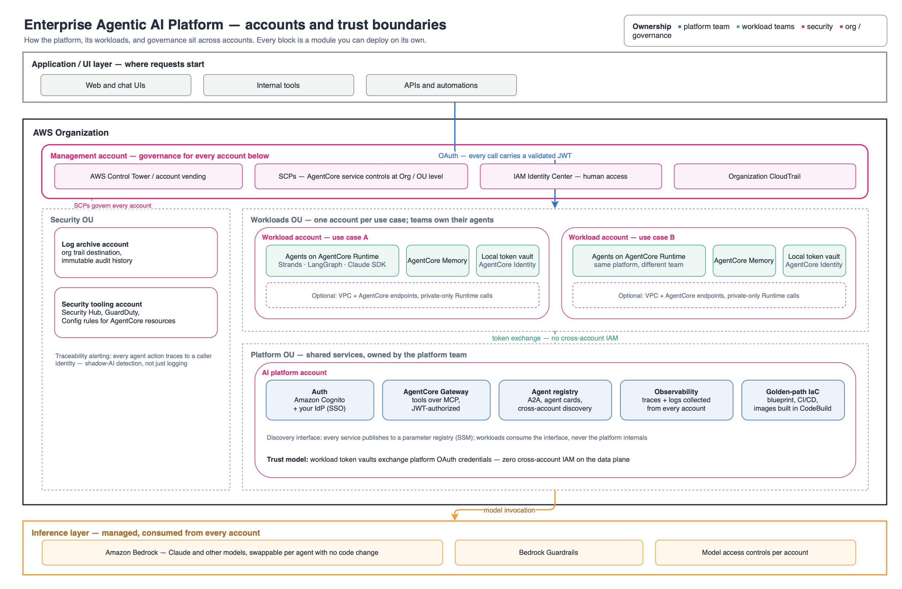
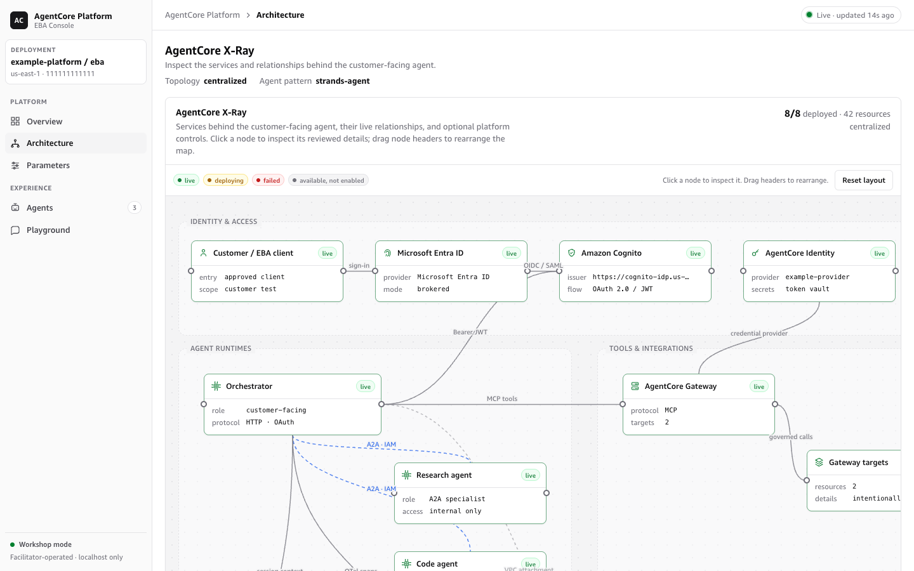

# Platform guide

How to design, build, verify and extend the platform itself. To deploy the platform with a
layer and a use case, start with the [quickstart](start/quickstart.md) instead.

## Design, build, verify

Three phases, three commands: **Design → Build → Verify**.

| Phase | What you do | Command | Where to start |
|-------|-------------|---------|----------------|
| **Design** | Pick a profile or write your own `platform.yaml` (accounts, identity provider (IdP), framework, controls); scaffold your use case into it; validate and see the exact stacks it produces. Nothing is deployed. | `./scripts/deploy.sh design --profile <name>`, `./scripts/deploy.sh usecase new <name>` | [Design](#design), [`PLATFORM_YAML.md`](PLATFORM_YAML.md) |
| **Build** | Create the platform and every use case in the design with one command. | `./scripts/deploy.sh build` | [Build](#build) |
| **Verify** | Test again everything the design promised, for the platform and the use cases; exits non-zero on any failure. | `./scripts/deploy.sh verify` | [Verify](#verify), [Dashboard](#dashboard) |

Before you build, run `./scripts/deploy.sh doctor`. It checks these, and changes no AWS
resources:

- your local tools;
- the effective account and Region;
- the required secret references;
- the Amazon Bedrock model metadata;
- the migration image inputs.

> **Doing this as a workshop?** [`PARTICIPANT_GUIDE.md`](PARTICIPANT_GUIDE.md)
> walks through the modules in order, with expected timings and what proves each one worked.
> When something breaks, [`TROUBLESHOOTING.md`](TROUBLESHOOTING.md) is
> organised by symptom.
> Migrating an existing container during an AWS Experience-Based Acceleration (EBA) workshop? Use the
> [`EBA Migration Runbook`](MIGRATION_RUNBOOK.md) for the supported path,
> secret handling, cutover, rollback, and evidence checklist.


## Profiles

Pick the profile that looks most like your job today. A profile is a configuration that
already fits together, so you do not start from an empty file. You can change your
deployment later.

| Profile | Good fit when you are... | Scope (guided modules) |
|---------|--------------------------|------------------------|
| `greenfield` | Building new agents from scratch | Identity, gateway, one agent runtime, and observability |
| `migration` | Rehosting a compatible container or source build as an arm64 AgentCore Runtime behind the supplied adapter | Identity, runtime migration, gateway integration, and observability |
| `multi-agent` | Building specialist agents that work together | Gateway, orchestrator, A2A runtimes, and observability |
| `platform-team` | Setting up shared infrastructure for your organization | Full platform, including memory, A2A, networking, and security |
| `security-focused` | Starting with compliance and hardening | One-agent platform, networking, security, policy, egress, and traceability controls |
| `production` | Preparing a long-lived customer baseline | Enterprise IdP, model allow-list, enforced Cedar and guardrails, networking, audit, alarms, encryption, and retained state |

A profile defines a starting footprint, which is the set of stacks and features a
deployment contains. `design --profile <name>` writes the profile's preset (from
`presets/`) to `platform.yaml` and prints the stacks it produces. Then `build` deploys the
validated design.

- The disposable profiles also work as guided lesson plans, through
  `workshop --profile <name>`.
- The `production` profile is intentionally design and build only. It refuses the guided
  workshop runner.
- Multi-account topologies have their own presets, `federated` and `distributed`. See
  [`MULTI_ACCOUNT.md`](MULTI_ACCOUNT.md).

The production preset is a hardened starting template, not a launch approval. Before a
launch, for the specific customer:

- replace all sentinels;
- complete the DRAFT governance artifacts listed in the
  [production readiness plan](PRODUCTION_READINESS_PLAN.md);
- pass the release gates.

Production mode fails validation if any of these are not configured: enterprise identity,
networking, audit, resource policies, egress controls, guardrails, enforced Cedar
authorization, model allow-listing, tracing, and monitored alarms. Its stateful resources
are kept when the stack is removed. What happens to them then must follow the customer's
approved retention and deletion plan.


## Getting Started

### Prerequisites

Before you deploy:

- **AWS credentials:** permission to create AWS Identity and Access Management (IAM), Amazon Cognito, Amazon Elastic Container Registry (ECR), AWS CodeBuild, Amazon Bedrock and Amazon Bedrock AgentCore resources. The deploy script validates them before it makes changes.
- **Amazon Bedrock model access:** enable access to the model your agents use (default: Anthropic Claude) in the Amazon Bedrock console, in the Region you deploy to. Deployment succeeds without it, but every agent invocation then fails at runtime.
- **Local tooling:**
  - Python 3.13 (as `python3.13`);
  - a Node.js LTS release that the AWS Cloud Development Kit (CDK) supports (20.19+, 22.12+, or 24), with npm;
  - AWS CLI v2;
  - bash 4+ (macOS ships 3.2 — `brew install bash`).

  The script checks these, and installs the AWS CDK CLI if it is missing. A container runtime is **not** required, because agent images are built remotely in AWS CodeBuild. A container runtime is only useful to test an image locally.
- **Region:** pick a Region where AgentCore and your chosen Amazon Bedrock model are available. The default is `us-east-1`.
- **Cost awareness:** networking profiles create a NAT gateway and virtual private cloud (VPC) endpoints, which are billed by the hour. Enabling Transaction Search changes account-level span pricing. Delete the resources when you finish testing.

After you create and complete `platform.yaml`, run the read-only preflight check:

```bash
./scripts/deploy.sh doctor
```

Every `[FAIL]` stops the build. A `[WARN]` is a decision or check that still needs a
person to validate it, such as the architecture of a pre-built migration image. A green
model metadata check proves that the configured model or inference profile can be
discovered. `deploy.sh verify` proves actual inference access after deployment.

### Architecture

[`ARCHITECTURE.md`](ARCHITECTURE.md) contains the request flows the repository verifies end to end, as a Mermaid diagram. It also shows how layers and use cases sit on the platform.



- Applications sign in once and send a validated JSON Web Token (JWT) with each request.
- Agents run in workload accounts, one per use case. The teams that build them own those accounts.
- The platform account contains the shared services.
- Cross-account trust uses OAuth token exchange. There is no cross-account IAM on the data plane.
- Governance and security tooling are in their own accounts, and apply to all the other accounts.

### Design

Pick a profile and let `design` write it to `platform.yaml`. Then edit the file until the plan it prints is the platform you want. Nothing is deployed in this phase. The only AWS call reads your account id.

```bash
# Install dependencies once
python3.13 -m venv .venv && source .venv/bin/activate
pip install -r requirements.txt

# Pick a profile: writes platform.yaml, validates it, prints the stacks it produces
./scripts/deploy.sh design --profile greenfield
# Other profiles: migration | multi-agent | platform-team | security-focused | production
# Or compose the axes (posture wins for security:, journey owns agents:):
#   ./scripts/deploy.sh design --journey migration --topology federated --posture hardened

# Edit platform.yaml (accounts, IdP and identity.mode, framework, controls...)
# and re-run `design` to re-validate. Every key: docs/PLATFORM_YAML.md
./scripts/deploy.sh design

# Read-only check of tools, AWS target, secrets, model, and migration inputs
./scripts/deploy.sh doctor

# Add your use case to the design (scaffolds use-cases/<name>/ and enables it)
./scripts/deploy.sh usecase new my-agent
```

### Build

One command creates the platform and every use case in the design. You can limit the build to one team or one module, or use the guided run. The modules are the guided run's numbered steps (such as 4, 6 and C), listed in [`PARTICIPANT_GUIDE.md`](PARTICIPANT_GUIDE.md#the-modules).

```bash
# Build the platform and the use cases in the design
./scripts/deploy.sh build

# Build a smaller scope instead
./scripts/deploy.sh build --team agent  # Agent team stacks only
./scripts/deploy.sh build --module 4    # Identity integration

# Build a design in CI/CD
NON_INTERACTIVE=1 AWS_REGION=us-east-1 ./scripts/deploy.sh build

# Use the guided run for explanations and checks after each module
# The script needs bash 4 or newer. macOS includes bash 3.2.
# Install a newer version with `brew install bash`, then run `bash scripts/deploy.sh ...`.
./scripts/deploy.sh workshop                        # Default profile: greenfield
./scripts/deploy.sh workshop --profile multi-agent  # Or migration|platform-team|security-focused
./scripts/deploy.sh workshop --from 6               # Resume at module 6
./scripts/deploy.sh workshop --dry-run              # Show the plan without AWS calls
```

`build` deploys up to six independent stacks at once. Each stack waits only for the stacks
it depends on. The stacks that create Cedar policies deploy one at a time.

On a test environment, you can use `./scripts/deploy.sh deploy --hotswap`, with or without
`--stack`. It replaces changed Lambda code in place in seconds, instead of running a
CloudFormation update. Know these limits:

- It skips changes it cannot hotswap.
- CloudFormation's record of each function stays out of date (drift) until the next full
  deploy.
- It is refused under `deployment.mode: production`.
- A release candidate always gets a full deploy.


### Verify

`verify` tests again everything the design promised, for the platform and the use cases alike. It exits non-zero on any failure. The other tools below test a single component when something is wrong.

```bash
export AWS_PROFILE=<your-profile>   # Skip if you use default credentials
# AWS_REGION is optional: the tools read the region you deployed with
# (platform.yaml or workshop.env). Set it only to override.

# Health check: runs every check your configuration promises (gateway, memory,
# observability, live agent invokes, ...) and exits non-zero on any failure.
./scripts/deploy.sh verify

# Invoke the deployed agent. Add --session <id> to continue a conversation.
# (Ask the default orchestrator about its role, not its tools — it delegates
# to sub-agents and deliberately has none of its own.)
python scripts/invoke.py "Hello! What kinds of tasks can you help with?"

# Use the AG-UI protocol for agui-* patterns.
python scripts/invoke.py --agui "Hello! What kinds of tasks can you help with?"

# List the gateway's MCP tools.
python scripts/invoke.py --tools

# Call the gateway directly: MCP tools/list and one tools/call.
python scripts/test_gateway.py
```

`invoke.py --agui` uses the Agent-User Interaction (AG-UI) protocol. `--tools` and
`test_gateway.py` use the Model Context Protocol (MCP). For the wider test plan, read
[`TESTING.md`](TESTING.md). For the status of deployed resources, use the
[Dashboard](#dashboard).

## Dashboard

The local EBA Console shows the deployed platform. It reads the same deployment contract
as `deploy.sh`. Its pages:

- **Overview** explains the deployment state.
- **Architecture** shows the AWS X-Ray service map, with nodes you can drag and the
  relationships it found in the deployment.
- **Parameters** shows the reviewed public interface.
- **Agents** lists the deployed runtimes.
- **Playground** lets a facilitator run controlled tests against the customer-facing
  orchestrator.

The Agent2Agent (A2A) specialists accept only IAM-signed calls. They are shown in the
architecture inventory, but the browser cannot call them directly. The console does not
create, edit, or delete agents.

Run both commands from the repository root. The console deliberately listens on localhost
only, and has no multi-user authentication. Use it as an EBA aid that a facilitator
operates, not as a hosted customer application. Playground prompts reach the deployed
runtime and may cost money for usage. So use only synthetic test data or test data the
customer has approved.

```bash
# Terminal 1: poller. Writes dashboard/public/status.json every 15 seconds.
# Polls the region you deployed with; set AWS_REGION only to override.
AWS_PROFILE=<your-profile> .venv/bin/python dashboard/monitor.py

# Terminal 2: loopback-only interactive EBA Console.
AWS_PROFILE=<your-profile> .venv/bin/python dashboard/server.py
# Open http://127.0.0.1:8888.

# Status-only fallback (Playground is disabled):
python3 -m http.server 8888 --bind 127.0.0.1 -d dashboard/public
```



## Clean Up

Destroy resources when you no longer need them.

```bash
./scripts/deploy.sh destroy

# Or destroy one stack.
./scripts/deploy.sh destroy --stack <stack-name>
```

Secrets you created yourself, such as an IdP client secret, stay in Secrets Manager. Each
layer and use case lists, in its own documentation, what else it leaves behind. To turn off one
use case and keep the platform, see [Use case removal](USE_CASE_REMOVAL.md).

For networking deployments, AgentCore network interfaces can stay for up to eight hours after a runtime is deleted. So a cleanup may need a retry. See [Network isolation](#runtimes-in-a-vpc-enable_networking) for the detail.


## Understand the AWS CloudFormation Stacks

### Stacks

Profiles select from these stacks.

| Stack | Resources | What it does |
|-------|-----------|--------------|
| `auth` | Cognito User Pool, 3 clients, SSM params — or, with `identity.mode: direct`, only the SSM params describing your Entra ID issuer | Sets up identity: Cognito with optional federated IdP, or your IdP as the issuer |
| `identity` | OAuth2 credential providers | Supports three-legged OAuth (3LO) delegation for Google, GitHub, and Notion |
| `memory` | CfnMemory + strategies | Adds long-term strategies (`agents.memory.strategies`), or short-term only |
| `gateway` | CfnGateway + Lambda targets | Exposes MCP tools with CUSTOM_JWT auth |
| `people-gateway` *(with `gateway.people`)* | A second CfnGateway, its interceptor, Cognito app clients for remote MCP clients | Lets people sign in as themselves from a remote MCP client ([People Gateway](modules/gateway.md#people-gateway)) |
| `runtime-orchestrator` | ECR, CodeBuild, CfnRuntime | Runs the main HTTP agent |
| `runtime-code-agent` | ECR, CodeBuild, CfnRuntime | Runs an A2A sub-agent for code tasks |
| `runtime-research-agent` | ECR, CodeBuild, CfnRuntime | Runs an A2A sub-agent for research |
| `observability` | Vended logs, X-Ray delivery | Collects monitoring data for each resource |
| `ops-topic` *(with alarms, or a use case or layer that sets `alarm_topic`)* | SNS topic, SSM param | Receives every alarm; its own stack so use cases need not wait for the runtimes |
| `networking` *(optional)* | VPC, private subnets, endpoints, runtime SG | Puts agents in your VPC ([details](#runtimes-in-a-vpc-enable_networking)) |
| `security` *(optional)* | KMS CMK, CloudTrail | Adds security hardening |
| `uc-<name>…` *(per enabled use case)* | Whatever its manifest lists under `stacks:` | Each stack follows the stacks that publish the SSM parameters it reads |

In this table, SSM is AWS Systems Manager, SNS is Amazon Simple Notification Service, SG is
security group, and KMS CMK is a customer managed key in AWS Key Management Service. Each
layer and use case lists its own stacks in its walkthrough.

## Customize, Operate, and Extend

Use these sections to change how the platform is deployed, secured, monitored or integrated:

| You want to... | Start here |
|----------------|------------|
| Configure the platform declaratively | [`platform.yaml`](#customize-a-deployment), starting from a preset in `presets/` |
| Use your corporate IdP (Entra ID, Okta, Ping) — federated through Cognito, or Entra ID as the issuer with no Cognito | [`ENTERPRISE_IDP.md`](ENTERPRISE_IDP.md) |
| Deploy across multiple accounts (federated) | [`MULTI_ACCOUNT.md`](MULTI_ACCOUNT.md) |
| Add your own tools to the gateway | [`GATEWAY_TARGETS.md`](GATEWAY_TARGETS.md) |
| Build a use case on top of the platform | `./scripts/deploy.sh usecase new <name>`, then [`CONTRIBUTING_USE_CASES.md`](../CONTRIBUTING_USE_CASES.md) with [`PLATFORM_INTERFACE.md`](PLATFORM_INTERFACE.md) |
| Rehearse an existing-agent migration in an EBA | [`MIGRATION_RUNBOOK.md`](MIGRATION_RUNBOOK.md) |

### Choose an Agent Framework

Each runtime stack builds one agent from the `agent-code/` directory. Pick the framework
you want here. The CDK infrastructure does not change. These are the platform's own agents.
A use case may build its own agent, whichever pattern you pick here.

Available patterns: `orchestrator` (default), `strands-agent`, `langgraph-agent`, `claude-sdk-agent`, `claude-sdk-multi-agent`, `agui-strands-agent`, and `agui-langgraph-agent`. A wrong value stops the deployment before it starts.

```bash
# Pick a framework. The script saves the choice in workshop.env for later runs.
AGENT_PATTERN=langgraph-agent ./scripts/deploy.sh deploy --module 6
```

In an interactive run, `./scripts/deploy.sh deploy` asks for the pattern. The guided
command prints the active pattern before its first module.

Use `deploy.sh` for every update to an existing environment, because it runs two things
that a plain CDK deploy does not:

- identity migrations, which update the consumers first;
- the checkpoints for credential rotation.

Direct `cdk deploy` is supported only for disposable test stacks, and for synth and diff
work. (Synth is the step where CDK builds the CloudFormation templates.)

The agent applications and shared utilities build on patterns from [fullstack-solution-template-for-agentcore](https://github.com/awslabs/fullstack-solution-template-for-agentcore) (FAST). The CDK stacks are specific to this repository.

### Track Costs per Component

Every stack is tagged with `Project`, `Environment`, and `Component`. `Component` is the
stack's suffix in the deployment contract, such as `gateway`, `memory` or
`runtime-orchestrator`, and use-case stacks have one too. To see the tags in Cost Explorer,
activate them once per payer account. The change takes effect within about 24 hours:

```bash
aws ce update-cost-allocation-tags-status --cost-allocation-tags-status \
  Status=Active,TagKey=Project Status=Active,TagKey=Environment Status=Active,TagKey=Component
```

Then group by the `Component` tag in Cost Explorer to split the cost per stack. The tags
assign *resource* costs: NAT, endpoints, CloudWatch, CodeBuild. There are two gaps:

- A few resource types, such as AgentCore Memory and SSM parameters, do not accept
  CloudFormation tags.
- Amazon Bedrock model inference, usually the largest cost, is not covered by resource tags
  at all. To assign inference costs you need application inference profiles, which this
  sample does not set up.

### Runtimes in a VPC (`enable_networking`)

Use this when your agents need private access to resources in your VPC, or stricter
outbound network controls. Set `enable_networking=true` to run runtimes in your VPC.

- AgentCore creates network interfaces in private subnets. It attaches them to a security
  group that allows only outbound HTTPS and no inbound access.
- Traffic goes out through the NAT gateway.
- Interface endpoints cover Amazon Bedrock, ECR, CloudWatch Logs, and AgentCore Gateway.
- ECR layer pulls use the free S3 gateway endpoint.

This is not an air-gapped VPC.

- **What you get:** no public network path from the agent, private access to resources in your VPC, and security-group control over destinations.
- **What you do not get:** the private subnets still have a NAT route, because agents call AWS APIs and some patterns use the public internet. Remove the NAT only after you add endpoints for every service your agents call.

Do not rely on the flag alone. After you deploy, confirm that the runtimes are actually in private subnets:

```bash
python scripts/check_network.py                  # Supported subnets and runtimes in the VPC
python scripts/check_network.py --expect-public   # Deployments without networking
```

> **Availability Zones:** AgentCore supports VPC connectivity in selected Availability
> Zones (AZs). An AZ name such as `us-east-1a` maps to a different AZ ID, such as
> `use1-az1`, in each account. So a VPC that works in one account can still fail when
> another account creates a runtime. `check_network.py` finds that problem during the
> networking module. The guided command runs it as module C's verification.

> **Teardown:** network interfaces can remain for up to 8 hours after a runtime stops
> using VPC mode. During that time, deleting the networking stack can fail, because the
> private subnets and runtime security group still have dependencies. The NAT gateway and
> VPC endpoints, which cause the hourly charges, are deleted in the same run. Try the
> destroy again after the interfaces are removed:
> `aws ec2 describe-network-interfaces --filters Name=interface-type,Values=agentic_ai`.

### Customize a Deployment

Every setting is in `platform.yaml`, and most also take an environment variable or CDK context
key (`-c key=value`). [`PLATFORM_YAML.md`](PLATFORM_YAML.md) lists every key with its
default, its override and what it does.

Deploying with `--profile <name>` writes the file for you from `presets/`. Or copy a preset yourself and validate it offline:

```bash
python -m infra_utils.platform_config platform.yaml
```

Interactive `./scripts/deploy.sh deploy` saves your answers in the gitignored `workshop.env`
file, and uses them on later runs. `deploy.sh` reads settings in this order, and the first
one found wins:

1. environment variables;
2. `platform.yaml`;
3. `workshop.env`;
4. defaults.

At synth, CDK context comes before all of them. Check the current values with
`./scripts/deploy.sh config`. Start over with `./scripts/deploy.sh config --reset`.

Secrets such as an IdP client secret or API keys are never written to `workshop.env`. They go to AWS Secrets Manager.

### Verify Caller Identity

Agents identify callers from the JWT in the `Authorization` header, not from the request body. See [`IDENTITY.md`](IDENTITY.md) for how token validation works, and why the agent checks the token twice.

### Search Agent Traces

Runtime traces do not appear until the account is configured to receive them. See [`TRACING.md`](TRACING.md) for the setup and verification steps.

### Alarms and the Platform Dashboard

Turn alarms on with `observability.alarms: true` (or `-c enable_alarms=true`). The
observability stack then also creates:

- CloudWatch alarms for each deployed resource:
  - runtime and gateway errors, throttles, and p99 latency;
  - memory event errors;
  - account-level Amazon Bedrock throttles and server errors.
- An SNS ops topic that receives every alarm and OK transition. It is in its own
  `ops-topic` stack, with its ARN in SSM at `ops-topic/arn`.
- A CloudWatch dashboard named `{project}-{environment}-platform`.

`INSUFFICIENT_DATA` is the normal state for the error alarms, because those metrics are
only sent when something fails. Set `observability.alarm_email` to subscribe an inbox. SNS
sends a confirmation email, and someone must accept it before notifications arrive. Verify
with `python scripts/check_alarms.py`. When the flag is on, `deploy.sh verify` also runs
this check.

### Extend the Platform with Other Stacks

New stacks can read values from the platform through SSM Parameter Store. These paths are available after deployment:

```
/{project}/{environment}/auth/issuer-url
/{project}/{environment}/auth/user-pool-id
/{project}/{environment}/auth/app-client-id
/{project}/{environment}/identity/gateway-credential-provider-name
/{project}/{environment}/gateway/url
/{project}/{environment}/memory/memory-id
/{project}/{environment}/runtimes/{component}/arn
/{project}/{environment}/ops-topic/arn
/{project}/{environment}/layers/{layer}/*        # each layer's own parameters
/{project}/{environment}/use-cases/{name}/*
```

[`PLATFORM_INTERFACE.md`](PLATFORM_INTERFACE.md) lists which of these are a stable interface.
Each layer and use case lists what it publishes in its walkthrough.
