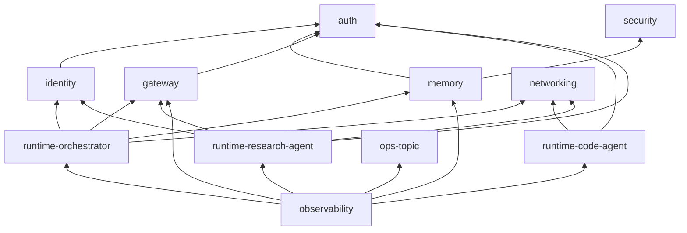

<!-- markdownlint-disable MD041 -->

# Modules

The platform is a set of CloudFormation stacks, each turned on or off by configuration.
A "module" here is one of those stacks: a unit you can deploy, verify, and
destroy independently. Which stacks exist for a given configuration is not a
convention — it is computed by `expected_stacks()` in
`infra_utils/platform_config.py`, the deployment contract that deploy plans,
verification, the dashboard, and destroy all consume. CI synthesizes every
preset and fails if the contract and the AWS Cloud Development Kit (CDK) app
(`app.py`) ever disagree. The set of stacks one configuration deploys is its
**footprint**.

## The modules

| Module | Turned on by | Purpose | Page |
|---|---|---|---|
| `networking` | `security.networking` / `ENABLE_NETWORKING` | Optional VPC, private subnets, endpoints, runtime security group | [networking.md](networking.md) |
| `security` | `security.cloudtrail_alerting` / `ENABLE_SECURITY` | AWS Key Management Service (KMS) customer managed key (CMK) for Memory encryption, CloudTrail audit trail | [security.md](security.md) |
| `auth` | always¹ | Cognito user pool, app/web/machine-to-machine (M2M) clients, optional enterprise identity provider (IdP) federation — or, in `identity.mode: direct`, no Cognito: only the issuer facts for your Entra ID tenant | [auth.md](auth.md) |
| `identity` | always | AgentCore Identity: gateway M2M credential provider, three-legged OAuth (3LO) providers | [identity.md](identity.md) |
| `memory` | always¹ | AgentCore Memory store (short-term; long-term opt-in) | [memory.md](memory.md) |
| `gateway` | always¹ | AgentCore Model Context Protocol (MCP) Gateway with Lambda tools, web search, optional Cedar + egress filter | [gateway.md](gateway.md) |
| `runtime-orchestrator` | always¹ | The selected agent pattern on AgentCore Runtime | [runtime.md](runtime.md) |
| `runtime-code-agent`, `runtime-research-agent` | `agents.a2a` / `ENABLE_A2A`² | Agent2Agent (A2A) sub-agents on their own runtimes | [runtime.md](runtime.md) |
| `observability` | always | Vended logs, Transaction Search, optional traceability alerting + alarms + dashboard | [observability.md](observability.md) |
| `ops-topic` | `observability.alarms`, or an enabled use case or layer whose manifest sets `alarm_topic` | The Amazon SNS topic every alarm publishes to (`ops-topic/arn`). It has its own stack, so a use case does not have to wait for the runtimes | [observability.md](observability.md) |
| `layer-<name>` | `layers.<name>` | A layer's stacks | [`layers/README.md`](../../layers/README.md) |
| `uc-<name>…` | `use_cases.<name>` | The stacks a use case's manifest lists under `stacks:` | [Platform interface](../PLATFORM_INTERFACE.md) |

¹ "Always" within the account's federated role — see
[Federated roles](#federated-roles-trim-the-footprint) below.
² The legacy env-var default for `ENABLE_A2A` is `true`, but the
`platform.yaml` schema default for `agents.a2a` is `false` — the two paths
deliberately differ (see the comment at the top of `app.py`).

## Dependency order

The edges below are the actual `add_dependency()` calls in `app.py`
(an arrow reads "depends on"). Optional stacks only contribute their edges
when they exist.

`networking` and `security` have no dependencies of their own; `observability`
deploys after every resource stack it monitors. Layer and use-case stacks are not
in the graph. Each one depends on the stacks whose AWS Systems Manager (SSM)
parameters it reads, and its manifest's `requires` is the fallback. So a
use-case stack that reads a layer deploys after that layer. A use-case stack
that reads only `auth/` deploys as soon as auth is deployed
([Layers](../../layers/README.md)).

## Guided workshop modules

`scripts/deploy.sh workshop` walks the platform module by module. Its
`MODULE_MAP` maps each guided step onto the stacks above:

- Module 3 deploys `auth`, and module 4 deploys `auth`+`identity`.
- Modules 5 and 7 deploy `gateway` (7 deploys it again to add tool targets).
- Modules 6 and B deploy `runtime-orchestrator`, and module 8 deploys the two
  A2A runtimes.
- Module 9 deploys `observability`, A `memory`, C `networking`, and E `security`.
- Module D (continuous integration and delivery, CI/CD) is guided-only and
  deploys no stack.
The numbers and letters are the
step ids that `deploy.sh workshop` prints and `deploy --module` accepts; the
map has no module 1 or 2. Each step prints a what/why
explanation (`MODULE_EXPLAIN`), applies the feature flags its stacks need
(selecting module C without `ENABLE_NETWORKING=true` would otherwise fail
with "No stacks match"), deploys, and runs that module's verification.

## Federated roles trim the footprint

In a federated multi-account deployment, `expected_stacks(account)` decides
the footprint by role. A **platform** account gets the shared services —
`auth`, `identity`, `gateway`, plus any enabled `networking`/`security` and
`observability` — but no agent runtimes and no memory. A **workload** account
gets the runtimes, its own `memory`, and its own `identity`, but no `auth` and
no `gateway`. Token vaults are account-local, so the workload account keeps the
platform M2M credentials in its own provider. It consumes the platform account's via pure
OAuth. The same `platform.yaml` deploys both sides; the account you deploy
into decides the role. See [Multi-account federation](../MULTI_ACCOUNT.md).
