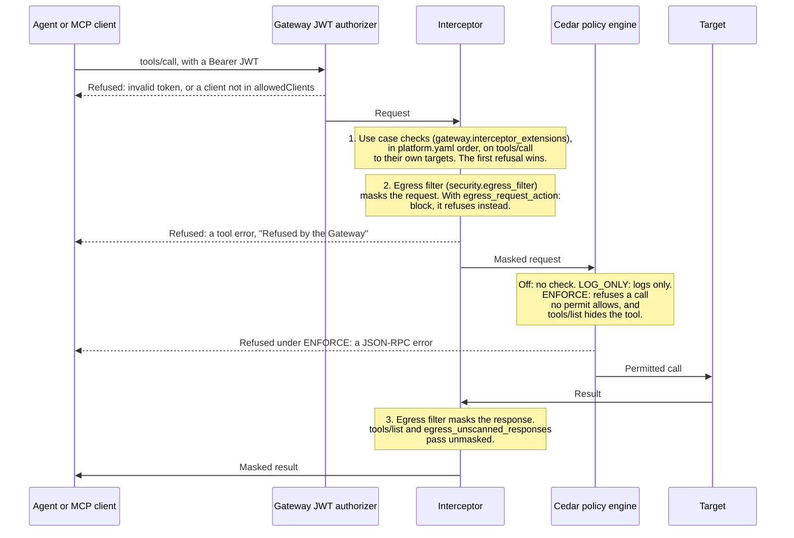

# Gateway module

The gateway stack (`stacks/gateway_stack.py`) deploys the AgentCore Gateway:
a single Model Context Protocol (MCP) endpoint through which every agent discovers and calls tools.
Tools are Lambda targets (your code) or built-in connectors (AWS-operated,
e.g. web search); optional controls add an Amazon Bedrock Guardrail egress
interceptor and a Cedar policy engine. Adding a tool here requires no agent
redeploy — see [Adding a gateway target](../GATEWAY_TARGETS.md).

## When it deploys

Per `expected_stacks()` in `infra_utils/platform_config.py`, the
`{project}-{environment}-gateway` stack is in every footprint (the set of
stacks a configuration deploys) **except a
federated workload account**. The gateway is a shared service, so workload
accounts consume the platform account's gateway URL via the
`deployment.federation` block instead. It depends on the auth stack (the
JSON Web Token (JWT) issuer).

## What it creates

| Resource | Name | Notes |
|---|---|---|
| `AWS::BedrockAgentCore::Gateway` | `{prefix}-gateway` | `protocol_type=MCP` (versions `2025-03-26`, `2025-06-18`), `authorizer_type=CUSTOM_JWT`, `exception_level=DEBUG` |
| Gateway IAM role | `{prefix}-gateway-role` | Assumed by `bedrock-agentcore.amazonaws.com` |
| Tool Lambda (one per tool) | `{prefix}-tool-<name>` | Python 3.13, ARM64, 30 s timeout, shared execution role |
| `AWS::BedrockAgentCore::GatewayTarget` (per tool) | `<name>` | `GATEWAY_IAM_ROLE` credentials, inline tool schema |
| Web-search connector target (flag) | `web-search` | Built-in connector `web-search` — no Lambda, no API key |
| Egress guardrail (flag) | `{prefix}-egress-guardrail` | `AWS::Bedrock::Guardrail` from `control-library` artifact `guardrail.egress-default` |
| Egress interceptor Lambda (flag) | `{prefix}-egress-interceptor` | Hooked on `REQUEST` + `RESPONSE` when the egress filter is on. Hooked on `REQUEST` only when `gateway.interceptor_extensions` alone creates it. `pass_request_headers` is true only if an extension sets `request_headers` |
| Cedar policy engine + policy (flag) | `{project}_{environment}_policy_engine` | One policy: `{project}_{environment}_PermitReadTools` (`cedar.gateway-default.permit-read`), limited to the Gateway's ARN. Policy names are unique per account and Region |
| AWS Systems Manager (SSM) parameters | `/{project}/{environment}/gateway/{url,id,role-arn}`, plus `policy-engine-id` (Cedar), `interceptor-role-arn` (extensions), `use-case-clients/<name>/<client>/{client-id,client-secret-name}` | The published platform interface ([PLATFORM_INTERFACE.md](../PLATFORM_INTERFACE.md)) |

Lambda tools are declared in `app.py`'s `tool_configs` dict (the shipped
example is `sample-tool` from `tools/sample_tool/`); the stack creates the
function, the invoke permission, and the target from each entry. The
`gateway.tools` key in `platform.yaml` is schema-validated but the deployed
tool list comes from `tool_configs` — adding a tool means editing `app.py`.

## Configuration

| platform.yaml | Env var / context flag | Default | Effect |
|---|---|---|---|
| `gateway.web_search` | `ENABLE_WEB_SEARCH` / `enable_web_search` | `auto` | `auto` enables the connector only in its launch regions (`us-east-1`, `eu-west-1`, `ap-northeast-1`); creating it elsewhere fails the deploy |
| `security.egress_filter` | `ENABLE_EGRESS_FILTER` / `enable_egress_filter` | `false` | Guardrail + interceptor Lambda on the gateway |
| `security.cedar.enabled` | `ENABLE_CEDAR` / `enable_cedar` | `false` | Attach the Cedar policy engine |
| `security.cedar.mode` | `CEDAR_MODE` / `cedar_mode` | `LOG_ONLY` | `LOG_ONLY` evaluates and logs; `ENFORCE` blocks |
| `gateway.people` | — | off | A second Gateway for people, with its remote MCP clients or an organisation's own issuer; see [People Gateway](#people-gateway) |

Use cases share one Gateway and one `allowedClients` list. With Cedar off or in `LOG_ONLY`, a
Gateway client of one use case can call another use case's tools wherever no interceptor check
refuses the call. So when more than one use case is enabled and Cedar is not `ENFORCE`,
`deploy.sh design` lists a warning and the synth prints it to standard error. Neither refuses the
manifest. `deployment.mode: production` requires `ENFORCE`. Turning a use case off deletes its
clients from that list ([Use case removal](../USE_CASE_REMOVAL.md)).

Precedence at synth (when `app.py` builds the templates): AWS Cloud Development Kit (CDK) context > env var > `platform.yaml` > default.
`deploy.sh` reads env vars, then `platform.yaml`, then `workshop.env`.
Flags match the exact lowercase string `"true"`.

## Interfaces

| Interface | Value |
|---|---|
| SSM | `/{project}/{environment}/gateway/url` — the published [platform interface](../PLATFORM_INTERFACE.md) |
| Stack outputs | `GatewayUrl`, `GatewayArn`, `GatewayId` |
| Consumed by runtimes | Injected as `GATEWAY_URL` (with `GATEWAY_CREDENTIAL_PROVIDER_NAME` from the identity stack) into the orchestrator and research-agent runtimes |

Callers authenticate with a Bearer JWT from the Cognito issuer; allowed
clients are the app client and the M2M client (federated workload runtimes
present the platform M2M client's token).

## Call sequence

The checks one tool call passes, in order. They sit in one place so that every tool call is checked
the same way, whichever agent or client makes it. The interceptor exists when `security.egress_filter`
or `gateway.interceptor_extensions` is set. Cedar exists when `security.cedar.enabled` is true.
A refusal at any step stops the call, and the target is never called.



AgentCore Gateway runs the REQUEST interceptor before Cedar. This repository does not set that order.
Because of it, a use case's checks can refuse a call in every Cedar mode, including when Cedar is off.
The egress filter masks data. It does not decide who may call what. Handler:
`tools/egress_interceptor/handler.py`.

## People Gateway

`gateway.people` creates a second Gateway, in its own stack (`{prefix}-people-gateway`). It is for
people who sign in as themselves from a remote MCP client: AWS Quick (`regions`) or Copilot
Studio (`callbacks`). The agent Gateway above serves agents only and admits none of these
clients. A separate Gateway keeps people's clients and their tokens away from the agents' tools.

```yaml
gateway:
  people:
    enabled: true
    remote_clients:
      - name: quick
        regions: [us-east-1]
```

| Resource | Name | Notes |
|---|---|---|
| Remote clients | `{prefix}-remote-<name>` | Cognito authorization code with a secret, `openid email profile`, 15-minute access and id tokens, 8-hour refresh tokens with rotation, revocation on, the pool's user identity providers, and a managed-login style each |
| People Gateway | `{prefix}-people-gateway` | MCP, custom JWT authorizer on the pool's issuer whose allowed clients are the remote clients alone (check 1); no policy engine |
| Resource server | `{prefix}-people-gateway`, identifier the people Gateway's URL | One scope, `people`. Quick sends RFC 8707 `resource=<url>`. Cognito issues a token for it, with that URL in `aud`, only when a resource server has exactly that identifier |
| People interceptor | `{prefix}-people-interceptor` | REQUEST only (check 2), described below |
| Gateway role | `{prefix}-people-gateway-role` | Trusted by this Gateway alone (`aws:SourceArn`). It may invoke the interceptor. A use case grants it access to the use case's own people targets |
| SSM parameters | `/{project}/{environment}/people-gateway/{url,id,role-arn}`, `remote-clients/<name>/client-id` | The published platform interface ([PLATFORM_INTERFACE.md](../PLATFORM_INTERFACE.md)) |

**No token passthrough.** The MCP authorization specification forbids a server to pass on
the token its client gave it. The people interceptor does the following:

1. It verifies the request's token again: RS256 with the pool's keys, the issuer and the expiry.
2. It requires an access token that a remote client received for this Gateway (`aud` is its URL,
   or the token has the `people` scope), and that names a `sub`.
3. In a `tools/call`, it replaces `arguments.caller` with the verified person (`sub`, `username`,
   `client`, `client_id`, `groups`), whatever the client sent.
4. It forwards the body alone. No target ever receives the token or any other header.

A request that fails any step receives a tool error and reaches no target. Each refusal is
counted (`{prefix}/people-gateway`, `Refusals`). The people interceptor has no knowledge of any use case.

**Attaching a people target.** A use case does three things:

- It creates a Lambda `CfnGatewayTarget` on `people-gateway/id`.
- It grants `people-gateway/role-arn` the permission `lambda:InvokeFunction` on that function
  alone. The synth (the step where CDK builds the templates) refuses any wider grant on the role.
- It names that role as the function's only invoker.

The target can trust `caller`, because only this Gateway can reach the target and its
interceptor sets `caller` on every call. Declare `caller` as an optional object in each
tool's input schema. The Gateway sets it.

- **Its secret.** It never leaves Cognito: no output, no parameter. The operator reads it on
  demand (`aws cognito-idp describe-user-pool-client`) to paste into the client.
- **Refused** under `identity.mode: direct`, with no remote client, and under
  `deployment.mode: production` unless each entry sets `allow_in_production: true`. Cedar is
  not required.
- **Revocation.** When you remove someone from a group, the change applies at their next
  access token, after at most 15 minutes. `aws cognito-idp admin-user-global-sign-out` ends
  their refresh tokens at once.
- **Client setup.** In Quick, a custom MCP connector with User authentication: the people
  Gateway's URL, the client id and secret, `<domain-url>/oauth2/authorize` and `/oauth2/token`,
  and the redirect Quick fills in. After a target's tools change, the connector owner presses
  **Sync**.

## An organisation's own issuer

Some organisations require a remote MCP client's connector to sign in through their own
identity provider. `gateway.people.issuer` makes that provider's OpenID Connect issuer the
people Gateway's, in place of the Cognito remote clients:

```yaml
gateway:
  people:
    enabled: true
    issuer:
      discovery_url: https://idp.example.com/.well-known/openid-configuration
      clients: [example-client-id]
      audience: gateway             # the people Gateway's URL; or a literal value
      subject_claim: sub
      display_claim: email
      groups:
        from: claim
        claim: groups
```

A Gateway's custom JWT authorizer takes one discovery URL (`CreateGateway`'s
`customJWTAuthorizer`), so it trusts the issuer or the pool, never both: the two are refused
together. The people Gateway's authorizer is its own, so an issuer is allowed under
`identity.mode: direct` too.

**What changes.** No Cognito client, login style or resource server is created. The
authorizer (gate 1) takes the issuer's discovery URL; with a literal `audience` it pins that,
and with `audience: gateway` (which it cannot name, since the URL is its own) it pins
`clients`, matched against `client_id`. The people interceptor (gate 2) then verifies each
token itself:

- an algorithm the discovery document lists, among RSA, RSA-PSS and EC; RS256 when it lists
  none; never `none` or HMAC; a `kid` from its `jwks_uri`, bound to that algorithm;
- the document's `issuer` is the one the discovery URL names, and the token's `iss` is that;
- `exp`, with a minute of skew; `aud` holds the audience; `azp`, `client_id`, `act.client_id` (an RFC 8693 on-behalf-of token) or `aud` names one
  of `clients`; the subject claim is set. There is no `token_use`, which only Cognito marks.

Every target gets the same `caller`, with `client: "issuer"`. The token still stops at the
interceptor.

**Groups.** With `from: claim`, the claim's values through `identity.group_map` when it has
entries (only mapped groups), else as written. With `from: pool`, the groups of the user pool
user whose email is the token's email claim: exactly one enabled user, its own email verified,
or the call is refused; cached for a minute. That links a token to a pool user by email, so it
needs `email_is_verified_by_issuer: true`, and is refused under `direct` (no pool). The
interceptor's role then gets `ListUsers` and `AdminListGroupsForUser` on this pool alone.

**At the identity provider**, set up:

- an OAuth client for each remote MCP client's connector, with that connector's redirect URIs
  and the authorization code grant, and its id in `clients`;
- the token's audience: the people Gateway's URL (the connector sends it as RFC 8707
  `resource`) with `audience: gateway`, or a value of your own with that literal;
- the claims: a subject, a display name, and the groups claim or a verified email.

The connector's Authorization and Token URLs are then the provider's, from its discovery
document, and the client secret goes only into the connector.
`<own>/people-gateway/issuer/{discovery-url,clients,audience}` publish what an operator needs.

## Security notes

- **Inbound auth is `CUSTOM_JWT`, always** — there is no unauthenticated
  code path; the authorizer validates against the issuer's OpenID Connect (OIDC) discovery URL.
- **The gateway role is scoped by naming convention**: `lambda:InvokeFunction`
  only on `{prefix}-tool-*`. With web search enabled it also gets
  `bedrock-agentcore:InvokeGateway` (own account) and
  `bedrock-agentcore:InvokeWebSearch` on the service-owned ARN
  `arn:aws:bedrock-agentcore:<region>:aws:tool/web-search.v1` — the literal
  `aws` account id is correct; both actions are documented requirements.
- **Cedar is implicit default-deny**: only explicit read permits ship (a
  blanket `forbid` would override every permit). The shipped permit is
  unconstrained on principal and limited to this Gateway. CreatePolicy rejects
  an open `resource` ("a wildcard resource was detected"). Narrow the
  principal before `ENFORCE`. See
  [Security controls](../SECURITY_CONTROLS.md), item 3.
- **The platform's egress filter masks, it does not authorize**: it applies
  the guardrail for masking personally identifiable information (PII) and
  blocking prompt injection. Platform-wide authorization is Cedar's job,
  behind its own flag. A use case's own checks in
  `gateway.interceptor_extensions`, such as the SAP layer's check and the run
  checks, run in the same interceptor. They may refuse calls to that use
  case's targets
  ([Checks in the Gateway interceptor](../../CONTRIBUTING_USE_CASES.md#checks-in-the-gateway-interceptor)).

## Verification

| Tool | What it proves |
|---|---|
| `scripts/verify.py` | Runs `test_gateway.py` whenever `gateway` is in the footprint |
| `scripts/test_gateway.py` | Real MCP `tools/list` + one `tools/call` with a live JWT |
| `scripts/invoke.py --tools` | The tool names agents actually see (`<target>___<tool>`) |

Synth-level checks for the flags (guardrail, interceptor, Cedar engine and
the absence of a `forbid`) are in [`TESTING.md`](../TESTING.md), A6–A7.

## Known issues

- **Connector and Lambda target configs go through
  `add_property_override`** — the L1 property mapping strips the `lambda`
  key (Python reserved word) and predates connector targets. Set via
  `target_configuration` and the target deploys with no tool, without an error.
  `tests/test_web_search_target.py` guards the connector case.
- **The web-search connector is deliberately not fixed to a version** — its
  default version follows Amazon's improvements, and a fixed dated version
  goes out of date.
- **Cedar names tools as `<TargetName>___<tool_name>`** — the same string
  `invoke.py --tools` prints. A permit naming anything else is dead code
  once `cedar_mode=ENFORCE`.
- **The interceptor uses the guardrail `DRAFT` version** and has no
  try/except around `ApplyGuardrail` — an Amazon Bedrock throttle appears as a
  Lambda failure, not a defined fail-open/fail-closed decision. Use a
  published version for production ([`TESTING.md`](../TESTING.md), caveats
  1–2).
- **The default `orchestrator` agent pattern has no tools at all** — to see
  gateway tools used, deploy a tool-consuming pattern
  ([Troubleshooting](../TROUBLESHOOTING.md)).
