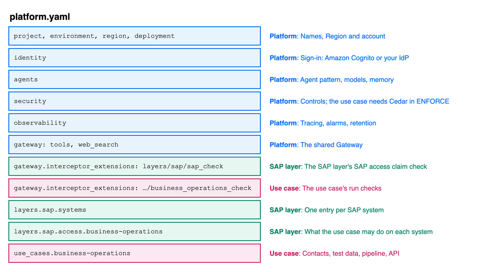

# Quickstart

This page deploys the platform and the SAP layer into one AWS account, connects one SAP system,
and adds one use case. Each step is one action, and each checkpoint says what you just proved.

A use case can also have its own quickstart, with the steps for that use case:

<!-- use-cases:begin quickstart -->
- [SAP exception handling](../../use-cases/business-operations/docs/quickstart.md) (`business-operations`): Business process agents for SAP exception handling, on the shared platform's Gateway, Cedar engine and interceptor.
- [Claude Code and Cowork on Amazon Bedrock](../../use-cases/claude-3p-on-bedrock/README.md#quick-start) (`claude-3p-on-bedrock`): Claude Code and Claude Desktop/Cowork on Amazon Bedrock through Anthropic's Claude apps gateway, with Microsoft Entra ID sign-in and per-team model access, on the platform's private network.
- [hello-sap](../../use-cases/hello-sap/walkthrough.md#enable-build-verify) (`hello-sap`): Reference SAP use case — reads SAP through the SAP layer as its own Gateway client, and writes nothing.
<!-- use-cases:end -->

> **Prefer to have an assistant do it?** Open the repository in an AI coding assistant that
> reads skills (such as Claude Code or Kiro) and ask it to "deploy this and connect it to SAP".
> The `start-here` skill finds the skill that deploys your use case. That skill asks you before
> it deploys. You type the SAP password yourself.

> **Before you connect to SAP**, review the
> [SAP API Policy](https://help.sap.com/doc/sap-api-policy/latest/en-US/API_Policy_latest.pdf) and
> your agreements with SAP. This is sample code. Use a sandbox SAP client.

## Prerequisites

| | |
|---|---|
| **AWS account** | Credentials that can create AWS Identity and Access Management (IAM) roles and the resources of the platform, the SAP layer and your use case |
| **Region** | One where Amazon Bedrock AgentCore and your models are available |
| **Model access** | In the Amazon Bedrock console for that Region: the Anthropic Claude Sonnet and Haiku models the platform uses, and any other model that your use case names |
| **Your machine** | Python 3.13, Node.js 20.19+, 22.12+ or 24 with npm, AWS CLI v2, bash 4 or newer (macOS ships 3.2: `brew install bash`), git |
| **SAP** | A **sandbox** client of SAP S/4HANA or SAP ECC, with:<br>- the OData (Open Data Protocol) services that your use case uses, active<br>- a System service user<br>- an HTTPS endpoint that AWS can reach, with a certificate from a publicly trusted certificate authority (CA).<br>Your SAP team's checklist: [SAP setup prerequisites](../../layers/sap/sap-setup.md#prerequisite-decisions) |
| **People** | Someone in your SAP team on call |

## 1. Get the code

```bash
git clone <this repository's URL> && cd <its folder>
python3.13 -m venv .venv && source .venv/bin/activate
pip install -r requirements.txt
```

## 2. Write `platform.yaml`

```bash
./scripts/deploy.sh design --profile greenfield
```

This writes `platform.yaml` from the `greenfield` preset, checks it and prints the stacks it
will create. Open `platform.yaml` and set the project name, the environment and the Region.

Then add the SAP layer's check, one entry for your SAP system, and Cedar in `ENFORCE` mode.
Merge each top-level key into the key that is already in the file:

```yaml
gateway:
  interceptor_extensions:
    - path: layers/sap/sap_check
      target_prefixes: [sap-]
      request_headers: true

security:
  cedar:
    enabled: true
    mode: ENFORCE

layers:
  sap:
    systems:
      s4:
        system_role: sandbox
        base_url: https://<sap-host>/sap/opu/odata/sap/
        client: "100"
        secret_name: <project>-<env>/sap/s4
```

[The SAP layer](../../layers/sap/walkthrough.md#enable) explains each key.



## 3. Add a use case

Choose one of the included use cases. Its page says what to add to `platform.yaml`: its entry
under `use_cases:`, its access row under `layers.sap.access`, and any interceptor check of its
own.

<!-- use-cases:begin enable -->
- [SAP exception handling](../../use-cases/business-operations/walkthrough.md#enable) (`business-operations`): Business process agents for SAP exception handling, on the shared platform's Gateway, Cedar engine and interceptor.
- [Claude Code and Cowork on Amazon Bedrock](../../use-cases/claude-3p-on-bedrock/README.md#quick-start) (`claude-3p-on-bedrock`): Claude Code and Claude Desktop/Cowork on Amazon Bedrock through Anthropic's Claude apps gateway, with Microsoft Entra ID sign-in and per-team model access, on the platform's private network.
- [hello-sap](../../use-cases/hello-sap/walkthrough.md#enable-build-verify) (`hello-sap`): Reference SAP use case — reads SAP through the SAP layer as its own Gateway client, and writes nothing.
<!-- use-cases:end -->

```bash
./scripts/deploy.sh design     # checks the file and prints the stacks it will create
./scripts/deploy.sh doctor     # checks your tools, account, Region and model; changes nothing
```

> **Checkpoint: the design is valid.** *You proved:* your configuration loads, and your machine
> and account are ready. *Why it matters:* the deploy stops on the same checks, but later and
> more slowly. *If not:* fix every `[FAIL]` that `doctor` prints, then run both again.

## 4. Store the SAP password

```bash
./scripts/deploy.sh layer run sap secrets s4
```

Type the SAP user and password at the prompt. They go to AWS Secrets Manager and never into a
file.

> **Checkpoint: the SAP secret exists.** *You proved:* the credentials are stored where the
> SAP layer reads them. *Why it matters:* the AWS for SAP Model Context Protocol (MCP) Server
> checks the secret when it starts. *If not:* run the command again. It stores a new version.

## 5. Deploy

```bash
./scripts/deploy.sh deploy
```

It shows the account, Region and stacks, and asks before it creates anything. The first deploy
takes the longest. Its summary lists the public outputs of each stack.

> **Checkpoint: the stacks are up.** *You proved:* the platform, the SAP layer and the use case
> deployed. *If not:* [Troubleshooting](../TROUBLESHOOTING.md) is organized by symptom.

## 6. Verify

```bash
./scripts/deploy.sh verify
```

Each check prints `PASS:` or `OK:` lines. The SAP layer's checks run after the platform's, and
each use case's own checks run last. The last line is
`OK: all <n> checks passed for this footprint`. The footprint is the set of stacks that this
deployment contains.

> **Checkpoint: the controls refuse what they should.** *You proved:* each SAP runtime and
> target is ready, and an SAP read from a client that no SAP access claim names is refused.
> The use case's own checks prove what it may read and write. *Why it matters:* this is the
> evidence that the guardrails are on, not only configured. *If not:* the `FAIL:` line names
> the cause.

## Clean up

```bash
./scripts/deploy.sh destroy
```

It removes the stacks. It reports, but keeps, the log groups, the secrets that `deploy.sh`
created itself, and any bucket that is not empty. `--yes` deletes those too. It never deletes
the SAP secret. Each use case says what else it leaves behind
([Clean up](../PLATFORM_GUIDE.md#clean-up)).

## Next steps

- [Next steps](next-steps.md), by role.
- [Concepts](concepts.md), for the terms on this page.
