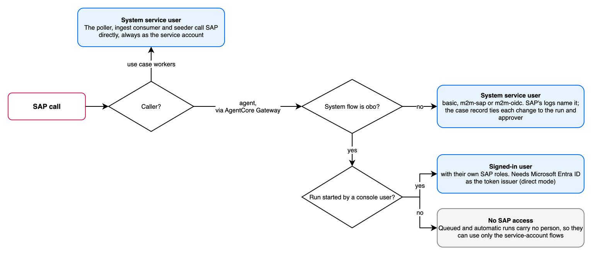

# The SAP layer

Terms are defined in [Concepts](../../docs/start/concepts.md).


> Before you connect to an SAP system, review the
> [SAP API Policy](https://help.sap.com/doc/sap-api-policy/latest/en-US/API_Policy_latest.pdf) and
> your agreements with SAP.

The SAP layer connects use cases to SAP. For each SAP system it deploys one
[AWS for SAP MCP Server](https://docs.aws.amazon.com/mcp-sap/latest/awsforsapmcp/introduction.html),
a Gateway target for it, and a check that refuses any SAP call that no use case's SAP access
claim names. It deploys as one stack, `<project>-<env>-layer-sap`, after the platform and before
any use case that requires it.

This is sample code: run each flow against your own SAP system before you rely on it.

| Page | Covers |
|---|---|
| This page | Enabling the layer, choosing a sign-in flow, connecting a use case, verifying |
| [Reference](reference/README.md) | Every setting, the resources per system, the event bus, the checks and the failure modes |
| [SAP setup](sap-setup.md) | What the SAP administrator configures |
| [SAP trust](sap-trust.md) | Token trust for the `m2m-sap`, `m2m-oidc` and `obo` flows |
| [Threat model](threat-model.md) | The SAP layer's threat register |

## Access paths

SAP is reached two ways.


- **Agent tools, through the Gateway.** The model calls `sap-<system>___<tool>`. The Gateway
  applies Cedar and the interceptor checks. Then it calls that system's MCP (Model Context
  Protocol) server, which signs in to SAP. The use case's **SAP access claim** says which of its
  apps may make these calls.
- **A use case's own workers, directly.** A poller, an ingest function or a test-data seeder
  calls SAP's OData (Open Data Protocol) API itself, outside the Gateway, as the system's service
  account. Only systems in the use case's `bypass_gateway` list can be called this way, and the
  SAP access claim is not checked. This path exists because no model and no run is behind these
  calls: they are the use case's own code, on a schedule or on an event.

## Enable

Add the layer's check and one entry per SAP system to `platform.yaml`:

```yaml
gateway:
  interceptor_extensions:
    - path: layers/sap/sap_check
      target_prefixes: [sap-]
      request_headers: true

layers:
  sap:
    systems:
      s4:                                   # at most 16 characters
        system_role: sandbox                  # required: sandbox, development, quality, production
        base_url: https://<sap-host>/sap/opu/odata/sap/
        client: "100"
        secret_name: <project>-<env>/sap/s4
    access:                                 # the operator's upper limit, per use case
      <name>: {read: "*", write: {s4: [function_import]}, bypass_gateway: [s4]}
```

- **`system_role`, `base_url` and `secret_name` are required.** The other keys have defaults
  ([system keys](reference/settings.md)).
- **`system_role` limits test data.** Only a `sandbox` system may be seeded with test data or
  have evaluations run against it.
- **`access` is the operator's upper limit for each use case.** Its access row says which systems
  the use case may read and write, and which its own workers may call directly. A use case with
  no row fails at synth (when the AWS Cloud Development Kit, CDK, builds the templates), and the
  error shows the line to add.
- **Why an access row and an SAP access claim both.** The use case writes its SAP access claim in
  its own stack, like the authorizations an SAP role requests. The operator's access row is the
  limit that claim must fit inside, so a use case's code cannot give itself more SAP access than
  the operator allowed.
- **Set a fixed server image before production.** `layers.sap.image_tag` defaults to `latest`,
  which `deployment.mode: production` refuses ([server image](reference/settings.md#server-image)).

## Sign-in flows

The `flow` decides whose authorizations SAP checks. Every flow except `obo` reaches SAP as one
service account, so SAP's logs name that account. `obo` (on behalf of) is what SAP calls
principal propagation. It reaches SAP as the SAP user that the person who started the run maps
to, with that user's own roles
([whose roles SAP checks](sap-setup.md#authorization-checks-in-sap)).



| `flow` | SAP runs as | What SAP receives | Secret | Also set |
|---|---|---|---|---|
| `basic` | The service user in the secret | A user and password | `{"username", "password"}` | |
| `m2m-sap` | The SAP OAuth client's own user (transaction SU01) | A client-credentials token that SAP created (transaction SOAUTH2) | `{"clientId", "clientSecret"}` of the SAP OAuth client | `token_url`, `scopes` |
| `m2m-oidc` | The service user SAP maps the machine token to | A client-credentials token from an identity provider (IdP) that SAP trusts | `{"clientId", "clientSecret"}` of the IdP app | `discovery_url`, `scopes` |
| `obo` | The signed-in person | A token that Entra issued for SAP from the person's token, through two on-behalf-of exchanges: at the Gateway, and again at the server | `{"clientId", "clientSecret"}` of the server's Entra app | `scopes`, `gateway_scopes`, and the platform's `identity.idp: entra_id` with `identity.mode: direct` |

Use `basic` for a demo. Use `m2m-sap` or `m2m-oidc` for a system that should not give out a
password. Use `obo` when SAP must authorize each person, and treat an `obo` system as read-only
([Writes, by flow](#writes-by-flow)).

Create the system's secret in the deployment's Region before you deploy, because the server
checks it when it starts. This command creates the secret, or writes a new version of it. It
reads both values from the terminal:

```bash
./scripts/deploy.sh layer run sap secrets <system>
```

The use case's direct callers sign in with the same flow, unless the system has an
[`unattended` block](reference/sign-in.md#unattended-sign-in). Rotating a client ID or secret
after the first deploy is untested ([credential rotation](reference/sign-in.md#credential-rotation)).

## Writes, by flow

| System | `writes` when you leave it out |
|---|---|
| `flow: basic`, `m2m-sap` or `m2m-oidc` | `[create, update, function_import]` |
| `runtime_arn` (bring your own) | `[create, update, function_import]`: set it to what that server has turned on |
| `flow: obo` | `[]`, no writes |

On the service-account flows, writes are on, so a use case that posts to SAP works on the first
deploy. Set `writes: []` for a read-only system, or list only what you need. Delete is never
available.

With Cedar off or in `LOG_ONLY`, only the interceptor checks can refuse an SAP write from a
client that an SAP access claim names. [Write details](reference/server.md#write-details)
explains why `obo` has no writes, and how `writes` limits each `access` row.

## Network paths to SAP

Everything runs on AWS. SAP is only the OData endpoint, and nothing is deployed on SAP Business
Technology Platform (BTP). Set `base_url` to the endpoint and give the platform a network route
to it:

| Where SAP runs | `security.networking` | You manage |
|---|---|---|
| SAP S/4HANA Cloud, SAP BTP, any public endpoint | Off (`PUBLIC`), or on (out through the NAT gateway) | Nothing extra |
| RISE with SAP on AWS | On | An AWS Transit Gateway attachment or VPC (virtual private cloud) peering to the RISE VPC, DNS and a certificate ([RISE with SAP](reference/network.md#rise-with-sap)) |
| On premises | On | AWS Site-to-Site VPN or AWS Direct Connect to the platform VPC |
| Amazon EC2 | On | The route, and SAP's own inbound rules admitting the layer's security group |

The layer's security group allows outbound HTTPS on port 443 and on each `base_url`'s port.
It allows these ports to any address (`0.0.0.0/0`), and no setting narrows the destination.
With `security.networking` off, the runtime runs in `PUBLIC` network mode and has no security
group, so SAP must be reachable from the internet. To limit where the runtime can connect, use
the network path: routes, network ACLs and SAP's own inbound rules.
SAP's endpoint needs a certificate from a publicly trusted certificate authority (CA), because the
server verifies it. [Network paths](reference/network.md) covers BTP and SAP Cloud Connector.

## Use case access

A use case reaches SAP in three steps:

1. **Require the layer** in its manifest: `requires: [..., layer-sap]`.
2. **Get an `access` row** in `layers.sap.access` from the operator ([Enable](#enable)).
3. **Write its SAP access claim and its Cedar permits** for its app clients, at synth, from its
   own stack:

   ```python
   from sap_layer import access

   sap = access.SapAccess(ctx, "<use case>")
   sap.claim(
       stack,
       callers=[client_id],
       read=["s4"],
       write={"s4": ["update"]},
       governed_by="<its interceptor check>",
   )
   sap.permits(stack, read=["s4"], write={"s4": ["update"]}, scope_prefix="uc-<name>")
   ```

The layer's check refuses any SAP call from an app that no SAP access claim names.
[Cedar and the interceptor checks](reference/use-case-access.md#cedar-and-the-interceptor-checks)
shows how Cedar, the layer's check, the use case's own checks and SAP's roles fit together. It
also shows which of them refuse in each Cedar mode.

The smallest working example is `layers/sap/tests/fixtures/vendor-lookup/`. The use cases in this
checkout are listed in [Use cases](../../use-cases/README.md). The whole API, including direct calls and event
subscriptions, is in the [reference](reference/use-case-access.md#use-case-access-api).

## SAP events

Polling is enough for most use cases. When one needs a case sooner, SAP can put an event on the
layer's `sap-events` bus, and the layer routes it to that use case's queue:

```yaml
layers:
  sap:
    systems:
      s4:
        # ... as above
        senders: [arn:aws:iam::<sap-account>:role/<sap-host-instance-role>]
    access:
      <use case>: {read: "*", bypass_gateway: [s4], ingest: [s4]}
```

`senders` are the IAM (AWS Identity and Access Management) roles that may send events for the
system, such as the SAP host's instance role. `ingest` lists the systems a use case may take
events from. The SAP side is a sample outbox, in ABAP (SAP's programming language), in
[`abap/`](abap/). The bus's policy, the subscription and the outbox setup are in
[The sap-events bus](reference/events.md).

## Verify

`./scripts/deploy.sh verify` runs the layer's checks after the platform's checks and before any
use case's. It checks that each runtime and target is READY, and that an SAP read from a client
no SAP access claim names is refused. A successful SAP read is checked by each use case's own
verify, because only a client that an SAP access claim names can make one.
[Verify checks](reference/verify.md) lists every check it runs.

## Troubleshooting

[Failure modes](reference/failure-modes.md) lists the errors at config load and at synth, and
the Gateway's refusals. For SAP's own 401, 403, 404 and 500 errors, see
[sap-setup.md](sap-setup.md#troubleshooting-sap-errors). On a token flow, also see
[sap-trust.md](sap-trust.md#troubleshooting-token-rejection).
