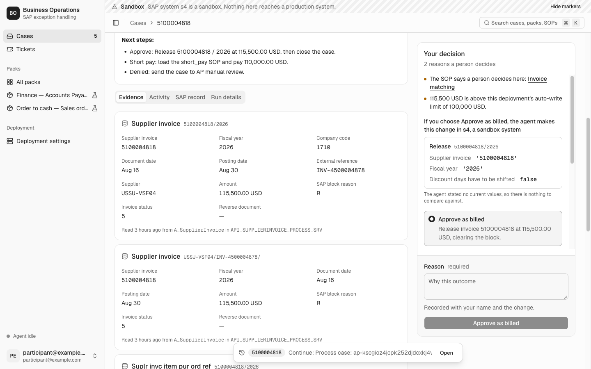
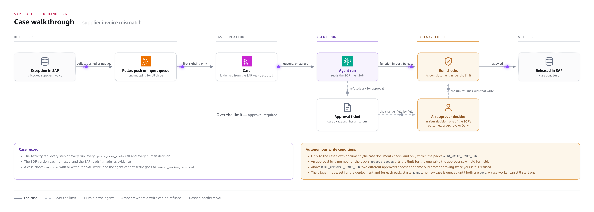

# SAP exception handling

An AI agent that clears SAP exceptions, such as supplier invoices blocked for payment, the way
your team already does: by following your written procedures. It posts the fix in SAP when the
change is under your limit, and asks a person to approve the exact change when it is not.


It runs on the [Agentic Business Platform Accelerator for SAP on AWS](../../README.md), in your
own AWS account. Its folder name, and its name in `platform.yaml`, is `business-operations`.
It is optional: it deploys only while `use_cases:` lists `business-operations`. Without it, the
platform and the SAP layer still deploy and pass `verify`.

[Deploy it](#quick-start) · [Take a tour of the console](docs/console.md) · [Add your own process](docs/packs.md)

## Features

It has the controls a finance team already expects of the people who clear these exceptions:

- **Procedures in plain language, not code.** Each kind of exception has a written procedure.
  Process owners edit it in the console, rehearse it against an example case, and publish it
  with no redeploy.
- **Every decision cites its source.** The agent names the procedure step it relied on, such as
  "Price variance 3.3", and shows each SAP record it read as evidence on the case.
- **A person approves the exact change.** Above your limit the run stops. The approver sees the
  change field by field, the procedure clause behind the stop and the limit it crossed. Above an
  optional second limit, two different approvers must agree.
- **It changes only the case's own document.** The agent writes only the case's own SAP
  document, and only with a grant for that run. Before each write, the pack's checks read SAP
  again.
- **It learns from good cases.** Closed cases that people rate well become examples for later
  runs of the same kind.
- **A full record for audit:** every SAP read, every decision and approval, and the procedure
  version the agent followed.
- **You decide when it runs.** New cases wait for an operator until you set the trigger mode to
  `auto`. An alarm sets it back to `manual`, and one command stops every run.
- **Eight procedures out of the box** for supplier invoices: price variance, quantity variance,
  missing goods receipt, missing purchase order, duplicate invoice, unit of measure mismatch,
  short payment and general invoice matching. Another SAP process is another pack.

## Example case

A supplier invoice for USD 25,000 is blocked for payment. The invoice becomes a case on the
next poll of SAP (every 15 minutes by default), or as soon as SAP sends an event. The agent
loads the procedure for invoice matching. It reads the invoice, the purchase order and the
goods receipt, and checks for a duplicate. Everything matches and the amount is under the
limit, so the agent releases the invoice and notifies the accounts payable team. This usually
takes one or two minutes.

The same invoice at USD 150,000 waits in the console for an approver:



## Case flow



1. **An exception appears in SAP**, such as a blocked invoice or a price or quantity mismatch.
2. **It becomes a case.** A poller reads SAP on a schedule (or SAP sends an event) and records
   one case per document.
3. **The business process agent works the case.** It loads the standard operating procedure
   (SOP) for that kind of exception: the written steps the agent follows. These pages call it a
   procedure. The agent reads the evidence it needs from SAP, and decides what should happen.
4. **A person stays in control.** The agent may post an SAP change on its own only if the
   change is for the case's own document and is under a limit you set. Above the limit the
   agent stops, and the change waits for an approver, who sees the exact difference. New cases
   wait for an operator until you set the trigger mode to `auto`, so a person decides when the
   agent starts work.
5. **Everything is recorded.** The case keeps every step, every decision, the SAP data the agent
   read and the exact procedure version it followed.

To change what the agent does, you edit the procedure in the console. No redeploy is needed.
The [architecture](#architecture) shows both ways a case arrives: the poller, which is the
default, and an event from SAP, which is optional.

## Quick start

You need an AWS account with Amazon Bedrock AgentCore, and a sandbox SAP S/4HANA system with a
service user. The Accelerator's [prerequisites](../../README.md#prerequisites) give the full list.

```bash
cp use-cases/business-operations/quickstart.platform.yaml platform.yaml  # then replace each CHANGE value
./scripts/deploy.sh layer run sap secrets s4   # stores the SAP user and password
./scripts/deploy.sh doctor                     # checks everything; changes nothing
./scripts/deploy.sh deploy                     # asks before it creates anything
./scripts/deploy.sh verify
```

Run these from the repository root. The [quickstart](docs/quickstart.md) explains each step,
then signs you in to the console and takes a first case through the agent. The
[walkthrough](walkthrough.md) explains each setting, from an empty configuration to a first
case.

## Architecture


The numbers in the diagram follow one case: the poller finds the exception in SAP (1) and
makes one case per SAP document (2). The agent queue starts one run per case (3). Each tool
call the agent makes is authorized on its own (4), and SAP reads and writes go through the AWS
for SAP MCP Server (5). A person starts a run by hand, or approves a change above the limit
(6). [Architecture](docs/architecture.md) describes each stack and component.

## Cost

The platform's [cost](../../docs/start/what-it-is.md#cost) applies. For this use case:

- **Cost per case:** each agent run calls an Amazon Bedrock model. This is usually the largest
  cost. A run starts only when a person starts it, or when the trigger mode is `auto`. Each pack
  sets a maximum that one run may spend.
- **Running cost while idle:** the storage of the knowledge features, when they are on.

The [cost page](docs/operating/cost.md) lists what drives the bill and the settings that lower it.

## Documentation

| Page | Answers |
|---|---|
| [Quickstart](docs/quickstart.md) | Deploy, verify and run a first case, step by step |
| [Walkthrough](walkthrough.md) | Each setting, from an empty configuration to a first case |
| [The operator console](docs/console.md) | Each screen, with screenshots: the cases, a case, an approval, the packs |
| [Process owner guide](docs/for-process-owners.md) | What the procedures decide, who may change what, and how to change a procedure safely |
| [Roles](docs/roles.md) | Who does what, from the AI engineer to the approver, which group grants each role, and the pages each role reads |
| [Glossary](docs/glossary.md), [FAQ](docs/faq.md) | The terms of this use case, and short answers |
| [Architecture](docs/architecture.md) | Stacks, components and data flow |
| [Lifecycle](docs/lifecycle.md) | What happens to one case, its statuses, and how case ids are built |
| [Configuration](docs/configuration.md) | Every setting under `use_cases.business-operations` |
| [Packs](docs/packs.md) | A pack's five parts and their owners; author, rehearse and move a pack; add a Gateway tool. Topic pages: [pack import at deploy](docs/packs/deploy-import.md), [edit rights](docs/packs/edit-rights.md), [SOP-cited values](docs/packs/sop-values.md), [promotion](docs/packs/promotion.md), [status](docs/packs/status.md), [Gateway tools](docs/packs/gateway-tools.md) |
| [Security](docs/security.md) | What stops a bad write: the run checks, Cedar, input fencing, audit alerts |
| [Controls and evidence](docs/controls-and-evidence.md) | Every path that changes SAP, who decides, and where the record is kept |
| [Operations](docs/operating.md) | Operator commands, observability, cost, the production checklist, troubleshooting, removal. Topic pages: [observability](docs/operating/observability.md), [break glass](docs/operating/break-glass.md), [cost](docs/operating/cost.md), [evaluation runs](docs/operating/evals.md), [removal](docs/operating/removal.md) |
| [Decisions](docs/decisions.md) | Why it is built this way |
| [Direct mode (Entra)](docs/direct-mode.md) | Running under `identity.mode: direct` |
| [Runtime reference](docs/reference/runtime.md), [threat model](docs/reference/threat-model.md) | Internals for whoever changes them |
| [Production checklist](docs/production-checklist.md) | What to complete before production |
| [Skills](skills/README.md) | Instructions for AI coding assistants |

Model Context Protocol (MCP) clients such as Kiro or Claude Code connect to the deployed Gateway
with the MCP servers for desktop clients: [tools/README.md](tools/README.md). The console:
[frontend/README.md](frontend/README.md).

## Security and license

This is sample code, not for production use as is. Before you use it with real data, work
through the [production checklist](docs/production-checklist.md) with your security and legal
teams.

**SAP API Policy.** Use of SAP APIs is subject to the
[SAP API Policy](https://help.sap.com/doc/sap-api-policy/latest/en-US/API_Policy_latest.pdf)
and your agreements with SAP. Review both before connecting this sample to an SAP system.

Licensed under the Apache License 2.0, like the rest of the [Accelerator](../../LICENSE).
