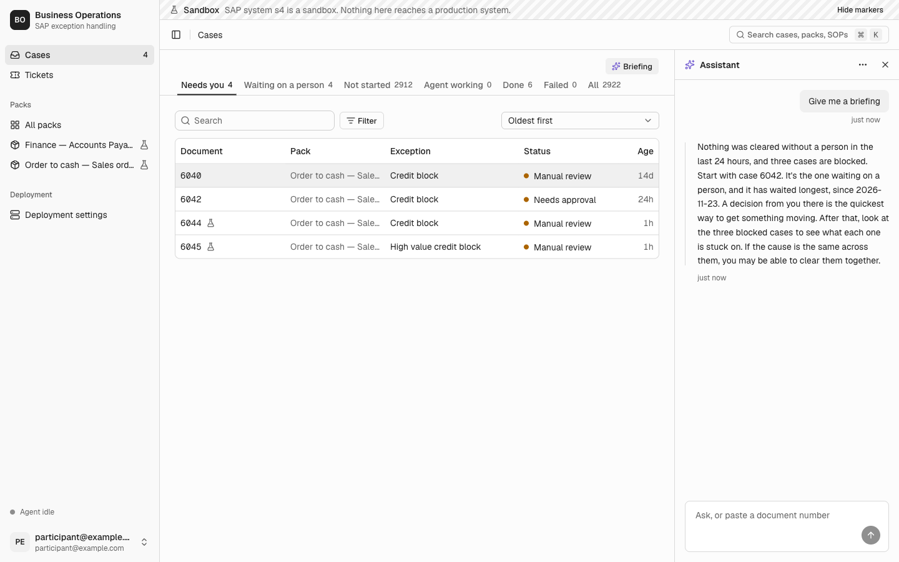
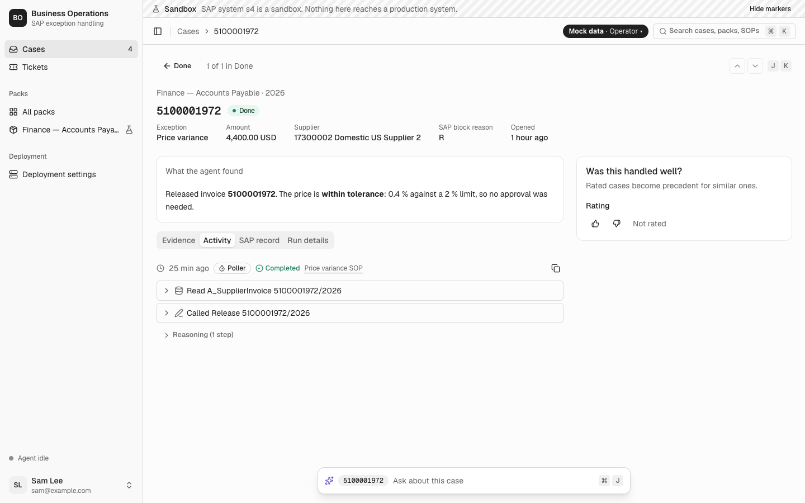
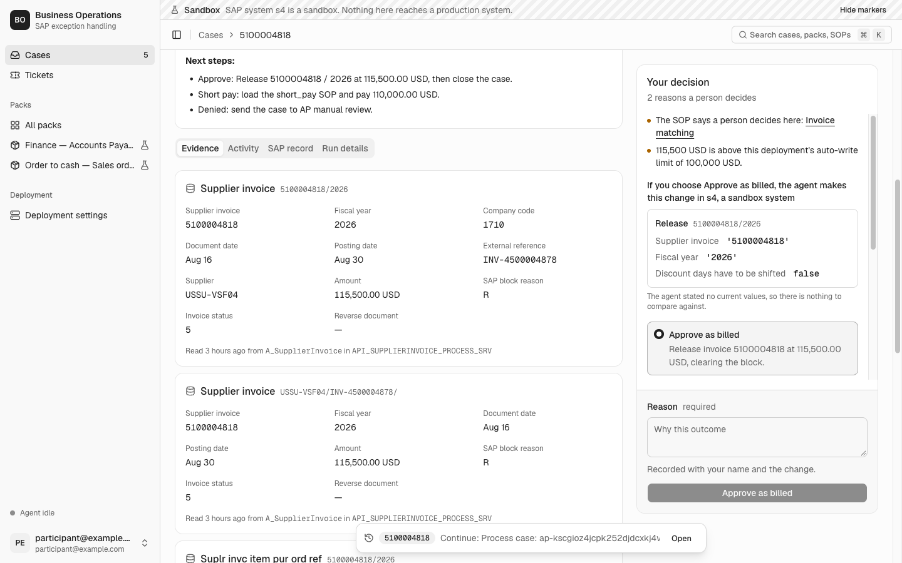
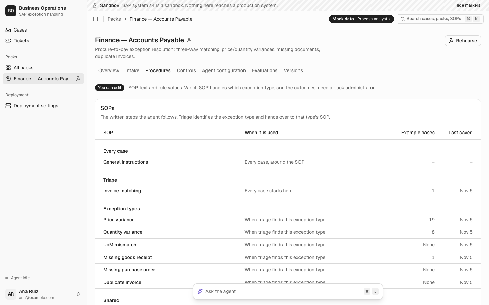

<!--
Copyright Amazon.com, Inc. or its affiliates. All Rights Reserved.
SPDX-License-Identifier: Apache-2.0
-->

# The operator console

Terms are defined in the [glossary](glossary.md) and in [Concepts](../../../docs/start/concepts.md).

The console is the web app where people work the cases. In it, people:

- see which cases need a decision;
- start the business process agent on a case;
- approve or deny the SAP changes the agent proposes;
- edit the standard operating procedures (SOPs). This page calls an SOP a procedure from here on,
  but the console's labels say SOP.

The console's address is the `ConsoleUrl` that the deploy prints. Who may do what in it is in
[Security](security.md#console-permissions). The screenshots below come from the console's mock
mode, with made-up cases on the shipped `finance_ops` pack.

The sidebar on the left shows the console's name and monogram. You set them with `console.brand`
in the use case's configuration ([Configuration](configuration.md)). The sidebar has links to:

- Cases and Tickets;
- the packs: all of them, and the ones you starred (if you starred none, the ones you can edit);
- **Deployment settings**;
- for administrators, the deployment's CloudWatch dashboard and the agent traces.

⌘B collapses the sidebar. **Search** (⌘K) finds a case by its document number, a pack, or a page.

The **ask bar** at the bottom of every page is a conversation with the agent. Ask about what is on
screen, and the answer opens in a panel on the right (⌘J). Asking never writes. To answer, the
agent reads SAP and the case. It has no tool that changes SAP, a case or a ticket, or that sends
mail. If you ask it to act, it tells you where to do that: **Process** on the case, or the case's
decision ([Runtime](reference/runtime.md#asking-and-processing)).

Times show as "12 min ago" within a day, and as a date after that. Point at a time, or move to it
with the keyboard, to see the full time. Every page works from the keyboard. Tab moves through the
page, and the focus is always visible. The first Tab offers **Skip to content**, and Escape closes
any panel or dialog.

## Cases

This is the first screen after sign-in. The views split the cases by what they wait for:

- **Needs you**: an approval or a reply that you may give, in the packs where you are an approver;
- **Waiting on a person**: every case in your packs that waits for a person, whoever may decide it;
- **Not started**, **Agent working**, **Done** and **Failed**.

A change that needs two approvers leaves your Needs you view once you give the first approval. It
stays in Waiting on a person until a different approver gives the second approval. The count beside
Needs you, the count in the sidebar and the counts in the exception filter change in the same way.
The console reads this from the action log of each such case.

Each row is one case. It shows the case's SAP document number, the exception the agent identified,
the status, the amount, who the case waits for, and for how long. A case that waits for a person
shows **Needs approval** when it waits for a decision and **Needs a reply** when the agent asked a
question. The header of the amount column sorts by amount: largest first, then smallest. A value
cut off at the edge of its column shows in full when you point at it or move to it with the
keyboard.

Search finds a case whose document number, party (such as the supplier) or case id starts with what
you type. You can filter by exception and by pack, several of each at a time. Each filter value is a
chip you can remove, and the exception filter shows how many cases of each exception type are in
the view. You can also sort the list. The server does the search, the filters and the sorting, so a
search covers every case and not only the cases on screen. **Load more** fetches the next page.

Sorting by amount works only when you filter the list to one pack, and it puts a case with no amount
below every amount. J and K move through the list, and Enter opens a case.

**Briefing** asks the agent for a briefing in the assistant panel: the queue and the last 24 hours.
**Done** starts with one line on what closed in the last 24 hours, 7 days or 30 days: how many
cases, the value released and what the agent cost. In **Not started**, select cases and press
**Start runs** to queue them for the agent.

On a new deployment, a one-line **First case** banner above the views shows the steps to a first
case: connect SAP, create a test exception in SAP (seed), start the case, decide on it, and set the
trigger mode to auto. The console checks each step against the current state. The banner goes
away once a case is done, or when you dismiss it.

## A case

- **The header** names the document and its status, with the amount and the other fields that the
  pack declares. J and K move through the view you opened the case from, and the stepper shows your
  position in it. When you open a case, its document number flashes once.
- **What the agent found** is the agent's closing summary. Its emphasis and lists show as they do in
  the assistant. Below it are the tabs:
  - **Evidence**: one card for each SAP record the agent read. The card's title is the record's name
    and key. Each field shows under the pack's label, and its SAP name shows when you point at the
    label. Amounts show with their currency. The card also says where and when the record was read.
  - **Activity**: every step of every run, each procedure lookup, each change and whether the
    Gateway allowed it, and the decisions people made. Each decision names the outcome, the person
    and the route, such as `denied by <name> via ticket`, or `Approve HOLD by <name> via ticket`
    for an outcome the agent offered.
  - **SAP record**: the case's fields, and the SAP field each one came from.
  - **Run details**.
- **On the right** is what the case needs: **Process** to start the agent, your decision or the
  answer the agent waits for ([Approving a change](#approving-a-change)), or a rating once the case
  is done. While the agent works, its steps show at the top of the page, with **Stop**.

  Of the ways to start the agent, only Process may change SAP, and only within the pack's limits.
  Process needs the case workers group, `business-operations-case-workers`. A pack can narrow this
  group with its `entitlement.process_groups`. A decision on a change still needs the pack's
  approver group. For anyone else, Process and **Run again** are disabled, with a tooltip that names
  the group. **Start runs** in Not started is disabled in the same way.

  When a member of this group starts a run, the agent may post changes under the auto-write limit
  without an approver. The pack's Controls part says this beside its groups.
- **Rating** (thumbs up or down) tells the agent which closed cases are good examples for later runs
  of the same kind ([Lifecycle](lifecycle.md#6-closure-and-feedback)).
- **Tickets**, when sample ticketing is on, opens the tickets the agent raised for this case.

## Approving a change

When the change the agent wants to post is above the pack's auto-write limit, the run stops. The
case waits in `awaiting_human_input`. **Your decision**, on the right of the case, shows:

- **Why a person decides.** This is the procedure clause behind the stop, with its number when the
  run recorded one, such as **Price variance 3.3**. Point at the clause to read the quote. The panel
  also says, in words, which limit the change crossed.
- **The exact change**, field by field, and the SAP system it will be written to, named with its
  system role.
- **The outcomes you can choose.** When the agent recorded the outcomes that the procedure allows
  (such as approve as billed, short pay or deny), each one is a choice. Each choice has one line on
  what it does and the change it makes, if any. Otherwise the choices are **Approve** and **Deny**
  for the change the agent proposed. **Reply only** sends the agent a message without a decision.
- **A required reason**, which the decision record keeps.

When you scroll, the panel keeps its title, the reason and the button in view. Only the content
between them scrolls.

The button names the outcome, such as **Approve as billed** or **Approve and release**. It adds "in
production" when the change goes to a production system. An approval lets the agent post exactly
the change of that outcome and nothing else. Before the agent posts it, the pack's write checks read
SAP again. **Deny** sends the case to `manual_review_required`.

After you decide, the case stays on screen. The panel shows what you sent: the outcome you chose,
your reason, whether it went to the agent or is **1 of 2 approvals**, and when. You cannot send it
again from there. **Next case**, or J, opens the next case; the button shows that case's document
number. Nothing moves on by itself. When another case opens, its document number and the stepper's
position flash once. You cannot withdraw a decision once the agent resumes.

Only members of the pack's approver group decide. For anyone else, the button is disabled and says
why. Above the pack's two-approver limit, the panel shows **1 of 2 approvals**, with who approved
which outcome and when. The first approval is recorded, and the case waits for a different approver,
who must choose the same outcome. If you try to approve a second time yourself, the console refuses
and says that a different approver must approve.

If the case changed after you opened it (another person decided, or a run ended), your decision is
refused, and **Refresh** shows the current state of the case. When the agent asked a question
instead of proposing a change, the panel shows the question and one answer box. **Send and resume**
gives your answer to the agent. A case with an approval ticket is decided in the same way, here or
from the ticket.

## Packs

**Packs** lists every pack you can see, one row each. A row shows the pack's active version, how
many procedures it has, the cases waiting for a person, and whether you can edit the pack. Starred
packs come first, and a star adds the pack to the sidebar.

**New pack** starts an incomplete pack. The poller ignores an incomplete pack until a pack
administrator completes it with real SAP values. The create form cannot give a pack an SAP write
tool, so nobody can grant SAP write access from a browser.

A pack's page has an **Overview**, one tab for each [part](packs.md#pack-parts) (**Intake**,
**Procedures**, **Controls**, **Agent configuration** and **Evaluations**) and **Versions**. A
process analyst first sees Procedures, and everyone else first sees Overview. After that, the page
opens on the tab you used last. Each part says whether **you can edit** it or it is **read only**,
and who changes it. A button you cannot use stays visible but disabled, and shows the reason when
you point at it.

- **Overview**: what each part contains and who owns it. Marked **Set here**, it also shows what
  this deployment sets for the pack: its trigger mode, its active version, its SAP system, and any
  limit lowered in this deployment.
- **Procedures**: the general instructions and the procedures, grouped as triage, exception types,
  shared and other names. It also shows:
  - the rules the procedures cite, each with the procedures that cite it (**Cited by**). A rule
    that a check reads before every SAP write is marked **Before writes**;
  - the outcomes a case may close with.

  Pack authors change the value of a rule with **Edit values**, which creates a new pack version.
- **Controls**:
  - the approval limits, with the pack's value beside this deployment's value. A member of
    `business-operations-limit-owners` may lower a limit with **Lower a limit**, and may never raise
    it. Where the pack names its own limit groups, the member must also be in one of them;
  - who works the cases and who approves;
  - the checks before every write, and the rules each check reads;
  - the verifier, if the pack turns it on. The verifier is a second, independent model that must
    agree with each payment write. It runs after the write checks pass and before the write. Any
    answer other than a clear agreement refuses the write and sends the case to a person.
- **Intake**: what becomes a case, how cases arrive, the fields a case shows and where each one
  comes from in SAP, and what the agent may read and change.
- **Agent configuration**: the model tier, the turn budget and the tools.
- **Evaluations**: the example cases, by group. Each one shows the outcome it must reach and the
  result of the last run. Open one to see the SAP test data it created, what it expected, and what
  the last run did. Evaluations run from the command line today, so **Run evaluations** shows the
  command.
- **Versions**: every version of the pack that this deployment stores, newest first. Each version
  shows who made it and when, the parts it changed, and how it became active here: an edit, the pack
  import at deploy, or an import with its change reference. Open a version to see what it changed
  compared with the version before it, by part and then by key:
  - each value before and after, in the rule's own units;
  - a line diff for the general instructions and for each procedure;
  - the example cases added, changed or removed.

  Below that is the version's content: `pack.json`, the general instructions and each procedure.
  It is read only.

Open a procedure to read it as a document, with each rule and contact shown as its value. **Edit**
opens an editor in which typing `{{` offers the pack's rules and contacts. The procedure check runs
as you type. **Save** stays disabled while the check finds a problem, and saving shows the
difference first. If you leave with unsaved changes, the console asks first.

**Rehearse** (on the pack and on each procedure) runs the saved procedure against a case you
describe, or against one of the example cases. The rehearsal does not get the tools that change SAP,
a case or a ticket. Its steps show on the page. You can keep a rehearsal that started from an
example case as a new example case, with **Save as example case**. You cannot keep a case described
in words, because the evaluations create the seed inputs of each example case in the sandbox before
they run it.

Make these changes in the development stage. A deployment in the quality or production stage
refuses a procedure or pack edit, and takes a change only as a promoted pack version. In such a
deployment, a banner on Packs, on each pack and on each procedure says **This stack takes packs by
promotion only**, and each edit is disabled with that reason. This keeps quality and production on
versions that were tested in development, in the same way that an SAP transport moves a tested
change. Contacts and lowered limits are set per deployment
([Process owner guide](for-process-owners.md#changing-a-procedure)).

When every SAP system the deployment connects to is a sandbox, development or quality system, a band
across the page says so. A flask icon marks a pack on such a system, and a case posted as test data.
**Sandbox markers** in the account menu hides these markers in your browser, for a demo. The
decision panel names the system either way.

## Deployment settings

This page shows what applies to every pack in the deployment:

- the deployment's [trigger mode](#trigger-mode), with the **Emergency stop** beside it;
- the notification contacts that the procedures of every pack name;
- the SAP systems the deployment connects to, each with its `system_role`.

Everyone can read the page. Administrators change the trigger mode, and use and clear the stop.
Pack authors change the contacts. What the deployment sets for one pack is on that pack's Overview.

**Emergency stop** sets the trigger mode to `manual` for every pack. It also stops every run in
progress, including questions and rehearsals. Its dialog says how many cases have a run in progress,
and it needs a one-line reason. A case that was being worked waits in **Manual review** for a
person.

The stop then stays in effect, and nothing new starts until an administrator clears it. While the
stop is in effect:

- Process, **Run again**, **Rehearse**, a question to the assistant, and a decision that resumes a
  case are refused. Each one shows the refusal, in the API's words, where you pressed it. The ask
  bar and the open assistant say that questions wait.
- Work already queued waits in the queue until the stop is cleared.
- No trigger mode can change to `auto`, for the deployment or for a pack. Setting one to `manual`
  still works.
- A band across every page says who stopped the deployment, when and why. It links to Deployment
  settings, which shows the stop beside the trigger mode.

**Clear the stop**, beside the stop while it is in effect, ends it. It needs a one-line reason. It
leaves the trigger mode at `manual`, because the trigger mode cannot be set to `auto` while the stop
is in effect. After the clear, when you are ready, set the trigger mode back, and start the stopped
cases from Manual review. Deployment settings then shows who cleared the last stop, when and why
([Break glass](operating/break-glass.md)).

## Tickets

When sample ticketing is on, **Tickets** lists the approval and question tickets the agent raised,
one line each, in status tabs with their counts. The list opens on **Open**. The **Tickets** link on
a case opens the list filtered to that case, shown as a chip you can remove.

Opening a ticket shows it in a panel on the right: what it asks, who it is assigned to, its comments
and a link to the case. While the ticket waits, the panel also shows the same **Your decision** panel
as the case page, which decides through the ticket. The sample ticketing stands in for your own IT
service management (ITSM) tool. Replace it before production.

## Trigger mode

Two trigger modes decide whether new cases start by themselves: the deployment's, on **Deployment
settings**, and one for each pack, on the pack's Overview. A case is queued for the agent only when
both are `auto`. The deployment's mode turns automatic starts on or off for every pack at once. The
pack's mode lets a new pack start at `manual` while another pack already runs at `auto`.

- **manual** (also shown as *not set* on a new deployment or a new pack): new cases wait for a person
  to press **Process**.
- **auto**: each new case is queued for the agent as soon as it is found, and each run costs money.
  On a deployment that has just started, that is every open exception SAP shows.

Both start at `manual`, because `auto` lets runs post changes up to the auto-write limit with nobody
watching. The trigger mode decides only when a run starts; the run checks decide what it may write.

Setting a trigger mode to `auto` asks you to type `AUTO`. Only administrators can change the trigger
modes. Containment, which acts on its own alarms, and the emergency stop set the deployment's
trigger mode to `manual`. Every change alerts the operations topic
([Audit-change alerts](security.md#audit-change-alerts)).
