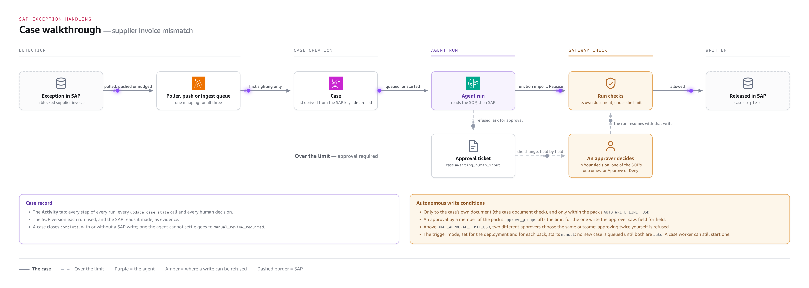
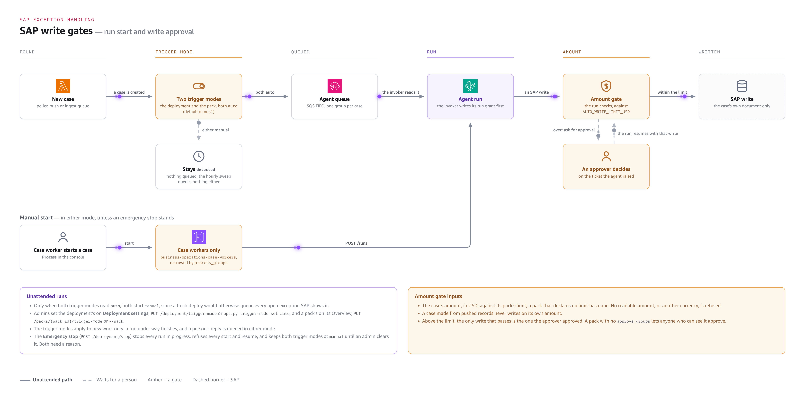

<!--
Copyright Amazon.com, Inc. or its affiliates. All Rights Reserved.
SPDX-License-Identifier: Apache-2.0
-->

# Case lifecycle

Terms are defined in the [glossary](glossary.md) and in [Concepts](../../../docs/start/concepts.md).

This page follows one SAP exception, from the moment it is true in SAP to the moment a person
agrees with what to do about it. [Architecture](architecture.md) names the components. This page
gives the order they run in.



([Animated version](diagrams/case-walkthrough.gif))

## 1. Detection

There are three ways in, and a deployment may use any of them. All three map records through the
same code (`pipeline/polling_engine.py`), so they make one identical case for one SAP document.

- **The poller asks SAP.** The SAP poller runs on `pipeline.poller_schedule`, every 15 minutes by
  default. It reads each published pack's `source` as the service account of the pack's
  `sap_system`, and it polls only the systems in
  `layers.sap.access.business-operations.bypass_gateway`.
  - Each poll reads every open exception that the pack's `source` matches, not only new ones, and
    skips the ones that already have a case. So a shorter schedule multiplies the load on SAP.
    The poller also reads the cases table once for each open record, one record at a time. On a
    test system with about 2,500 open records, one poll took about 21 seconds. With a large
    backlog, keep the schedule long, narrow the pack's `source` filter, or close old exceptions
    in SAP.
  - A record that the pack's mapping cannot read (an amount of `n/a`) is counted as `rejected` in
    the log, and the rest of the pack is still ingested. No record value is logged.
  - A pack's `source.poll` chooses which run reads it. `schedule` is the default. `sweep` is only
    the slower `pipeline.sweep_schedule` (hourly by default), for a pack that SAP pushes. `off`
    means never: push only.
  - `ops.py poll <pack>` polls one pack now, whatever its `poll` setting. `ops.py poll` alone runs
    the `schedule` packs.
- **SAP puts an event on the SAP layer's bus.** This needs `layers.sap.systems.<system>.senders`,
  and the system in `layers.sap.access.business-operations.ingest`.
  - The SAP layer gives the system a sender role. That role may put events on the layer's
    `sap-events` bus only with `source` `sap.<system>`.
  - This use case subscribes to those events with one rule, `detail-type` `business-operations`.
    The rule routes them to the use case's one ingest queue (deploy output `IngestQueueUrl`), and
    uses the queue's dead-letter queue as its own.
  - SAP's drain job sends the message as the event's `detail`
    (`layers/sap/reference/events.md`).
  - Every `ingest` system must also be in `access.bypass_gateway`, because the consumer answers a
    nudge by reading SAP.
- **SAP posts to `POST /erp-events`.** This needs `api.erp_events_endpoint: true`, and the route
  is on its own RestApi.
  - The route takes a nudge, or the typed envelope `{"pack_id", "timestamp", "records"}` with 1 to
    100 records shaped like the pack's `source`.
  - It checks the message the same way the consumer will. Then it puts the message on the same
    ingest queue as a bus event, with `source` `sap.<the pack's sap_system>`, and answers 202.
    The consumer makes the case.
  - A refused message answers 400 (413 when too large) with its reason. A failed enqueue answers
    500, so SAP sends the message again. A message sent again creates nothing twice.
  - The caller presents one of two credentials. The first is the generated 48-character token,
    as `Bearer` or as the password of a Basic header. In SAP, an SM59 type-G destination (an HTTP
    connection to an external server) keeps it in its password field. The token's secret is the
    deploy output `ErpEventsTokenSecret`.
  - The second credential, on a Cognito pool, is an access token of the use case's ingest client
    with scope `business-operations-ingest/send`. The caller gets it with client credentials at
    the pool's `/oauth2/token`. The client's id and secret are in AWS Systems Manager (SSM)
    Parameter Store, at `use-cases/business-operations/ingest-client-id` and
    `ingest-client-secret-arn`.
  - Either credential is valid for every system that this use case calls directly. The pack named
    in the message decides which system the message is for.

Only the rule and `POST /erp-events` may write to the ingest queue: its policy denies
`sqs:SendMessage` to every other principal. The queue and its dead-letter queue are encrypted
with the use case's own AWS Key Management Service (KMS) key, alias
`<project>-<env>-business-operations-ingest`. The key's policy lets Amazon EventBridge encrypt
into them for this account's rules only. The consumer reads the system from the event's
`source`. It refuses a source it does not serve (`unknown-source`), and a `detail-type` other
than `business-operations` (`topic`).

A **nudge** is `{"version": 1, "pack_id", "keys": [{...}]}` (`types/sap-nudge.schema.json`). It
contains the pack's key fields on the entity the pack queries (for `finance_ops`,
`SupplierInvoice` and `FiscalYear`), at most 50 keys and 16 KB. The consumer runs the pack's own
query again, narrowed to those keys. So a key that is not an exception in SAP makes no case. A
nudge with no `keys` polls the pack now. The consumer writes each key value into the `$filter` as
a quoted string (`Field eq 'value'`). That is right for `Edm.String` keys, such as those of
`finance_ops`. A pack whose key field is a number or a date gets a filter that SAP refuses, so
give such a pack string key fields, or use polling only.

A pack's `source.push` decides what the pack accepts:

- `nudge`: the default for a polled kind.
- `records`: also the typed `/erp-events` envelope. Its records are made into cases as sent, so
  they are only as true as the sender. Kind `event` needs it.
- `off`.

A message is refused for an unknown pack, a pack of another system, a message that is too large,
a key value outside `[A-Za-z0-9._/-]`, or an unknown source or topic. A refused message is
counted as `IngestRejected` by reason, and is dead-lettered after three tries. So is a message
whose SAP read keeps failing. Both raise an alarm, and so does a rule that cannot deliver to the
queue (`FailedInvocations`).

The poller keeps running, so it finds what a sender lost. A sender loses a message when an
outbox is stuck, a drain job stopped, a send was refused, or a BAdI (Business Add-In, an SAP
extension point) was not called. The poller counts each such case:

- On a system in `ingest`, a case that the poller makes for a pack that sets `push` (`nudge` or
  `records`) is one that the nudge should have made first.
- The default `push` is not counted, so a pack that no sender covers never raises an alarm. Set
  `push` on each pack the sender covers (`finance_ops` does).
- The poller logs one `IngestMissed` line naming the pack and the document's key.
- It raises an alarm after misses in two polls in a row. A document posted just before a poll
  can be found by that poll before its own nudge arrives, once. A sender that stopped misses
  every poll.

A pushed pack can set `poll: sweep`, so that it is read again hourly instead of every 15
minutes. With `poll: off`, nothing notices a sender that stops, so the synth warns about it. Both
`sweep` and `off` need a `push` other than `off`.

The SAP side of the bus is the SAP layer's generic outbox (`layers/sap/abap/`, in ABAP, SAP's
programming language). This use case's `INVOICE_UPDATE` BAdI implementation calls
`zcl_aws_evt_outbox=>record( iv_topic = 'business-operations' iv_body = <the nudge> )`, and the
layer's drain job sends it. `docs/abap/` contains that implementation for `finance_ops`.

**Mail replies are an extension; they are not shipped.** A reply to a notification reaches no
case. To read replies from a mailbox, add a producer beside the poller. The producer must:

- admit only mail that the mail system confirms: the email checks SPF, DKIM and DMARC passing
  under the mail system's own `Authentication-Results`;
- route only on the `Case ID:` line quoted from the agent's own notification;
- queue the case through `pipeline/case_store.py` as a person.

The producer is a new inbound path, so it needs its own threat-model row.

## 2. Case creation

One row in the cases table, keyed by `case_id`, its only partition key:

```
{short_id}-{first 26 chars of base32(sha256(pack_id, natural key)), lowercased}
ap-6a5da47jnjsz3ihuo7hqvgomfd
```

`short_id` is the pack's code of two to eight characters (`source.short_id` in `pack.json`), so
an id on a screen still shows which pack it belongs to. The digest covers the pack id and the
natural key. The natural key is the map of SAP fields to values that the pack's `source.key`
declares, sorted by field name. So:

- **The id is derived, never generated.** The poller, a push and a nudge create the same id for
  the same document. A second sighting finds the existing case instead of making a duplicate.
  Field order does not matter: `{"SupplierInvoice": "5100001976", "FiscalYear": "2026"}` and the
  same two fields reversed are one case.
- **Any key shape fits.** Any number of fields, and values with `-`, `/` or spaces. The id is at
  most 35 characters of `[a-z0-9-]`. It is safe without escaping in a URL, an SQS
  `MessageGroupId`, a Memory session id and an AppSync channel segment.
- **Renaming a pack's `pack_id` or `short_id` gives its documents new case ids.** Treat both as
  identity.

The case stores `key` (the natural key) and `title` for display, and log lines print both.
`GET /cases?key=<pack_id>:<json>` finds the case for a natural key. The run's AgentCore session
id is `erp-case-<case_id>`. That prefix is reserved, so `POST /runs` refuses it as the session id
of a run with no case. Two codecs, `agent/utils/case_key.py` (creates and reads ids) and
`frontend/src/lib/caseKey.ts` (reads ids), are tested against `types/case-id-vectors.json`.
Regenerate a row there with `case_key.derive_case_id`, never by hand.

## 3. Queueing



([Animated version](diagrams/autonomy-gates.gif))

The trigger mode has two levels: one for the deployment and one for each pack. A case is queued
unattended only when both are `auto`. The two levels exist for different reasons. The
deployment's trigger mode stops every pack at once, which is why containment and break glass set
it. A pack's trigger mode lets its owners turn on unattended runs for that one pack, when they
trust it.

Both start as `manual`, and an unset mode is `manual`. So new cases stay `detected`, and nothing
is queued until an operator starts one from the console.

- An admin sets the deployment's mode with `PUT /deployment/trigger-mode` or
  `ops.py trigger-mode set auto`.
- An admin sets each pack's mode once, with `PUT /packs/{pack_id}/trigger-mode` or
  `ops.py trigger-mode set auto --pack <pack_id>`. A newly imported pack starts on `manual`.
- When both are `auto`, cases are queued as they are found, and the hourly sweeper queues the
  cases that `manual` left.
- When containment or break glass sets the deployment's mode, each pack keeps its own mode. That
  mode applies again when the deployment's mode goes back to `auto`.

The `manual` default is deliberate. The poller keeps no first-run baseline, so `auto` on a fresh
deploy queues every open exception SAP shows it, and each one is a paid run.

A person's reply to the agent's own question, by console or ticket, is queued whatever either
mode says. The trigger mode is checked when a case is ingested, so `manual` stops work from
starting. It does not stop a run already under way. The emergency stop (`POST /deployment/stop`)
does both. It stays in effect until an admin clears it. While it stands, nothing is queued, no run
starts, and no mode can change to `auto`
([break glass](operating/break-glass.md#emergency-stop)).

With `pipeline.warm_delay_seconds`, a burst of cases for one pack waits behind its first case, so
the first run fills the prompt cache for the others.

## 4. Agent run

The invoker reads cases from the FIFO (first in, first out) queue, and runs at most
`pipeline.max_concurrency` of them at once. Before each run, it writes a **run grant**: the run,
its client, its case and pack, any approval, and an expiry. Then it invokes the runtime. The run
checks refuse case tools and SAP writes without a grant, so only a real run that the invoker
started can change a case or SAP. The invoker deletes the grant when the run ends.

The agent follows a standard operating procedure (SOP), called a procedure on this page. Every
case starts with the pack's triage procedure (`source.process_type.default`), unless the pack's
rules send it straight to an exception procedure. The SAP record that makes a case does
not say which kind of exception it is, so the triage procedure identifies the exception type and
then loads that type's procedure. The agent:

1. finds the pack's prompt and procedure for the case's `process_type`. `load_sop` returns the
   whole procedure, with tolerances and contacts filled in;
2. reads what it needs from SAP through the Gateway. Every call passes the run checks and Cedar;
3. searches procedures, API docs or precedent, where the pack offers those tools. Precedent is
   earlier cases of the same kind that people rated (see [Closure and feedback](#6-closure-and-feedback));
4. records its reasoning, its evidence and its proposed SAP write on the case as it goes.

When the run ends, the runtime writes its trace. In the same update, it writes the case's
`exception_type`: the last exception procedure of the case's own pack that the run was given,
whether the run was routed to it or `load_sop` served it. A triage or shared procedure is never
recorded, and nothing the model writes sets it. `process_type` keeps the type the case was
created with ([Kinds of SOP](packs.md#kinds-of-sop)).

Every AG-UI (Agent-User Interaction protocol) event is published to the case's run channel. So
any console tab entitled to the pack can watch a run it did not start
([runtime reference](reference/runtime.md)).

## 5. Human decision

The agent may write when the write is within its pack's `AUTO_WRITE_LIMIT_USD`, and names the
case's own document (`case_document_check`). Above the limit, the run checks refuse the write and
tell the agent to raise an approval. The agent raises a ticket that includes the
`proposed_write`, and the case goes to `awaiting_human_input`. The console shows that write as a
diff.

A member of the pack's `approve_groups` approves, denies or answers. They do it from the console
(`POST /cases/{case_id}/reply`) or from the ticket, and both go through one check
(`decisions.authorize`).

Above the pack's `DUAL_APPROVAL_LIMIT_USD`, where the pack declares one, the write needs two
approvers:

- The first approval is recorded but resumes nothing. The reply is `202` with
  `awaiting_second_approver`, and the ticket stays open.
- The run resumes when a different approver approves the same write.
- The same person approving it again is refused (`409`, "a different approver must approve it
  too"), and nothing is recorded.
- A denial from either approver ends it.
- On a case that a sender pushed, the first approval always waits for a second, because the
  case's amount is the sender's word and not SAP's.

An override may lower `DUAL_APPROVAL_LIMIT_USD`, never raise it, and it may not be below
`AUTO_WRITE_LIMIT_USD`. A pack declares `DUAL_APPROVAL_LIMIT_USD` only beside
`AUTO_WRITE_LIMIT_USD`.

An approval is bound to the latest proposed write, field for field. The invoker reads the
approval from the case's action log, never from the queue message. The resumed run may make that
one write, and every other write must still be within the limit. [Security](security.md) has the
full list of what the run checks refuse.

The procedure may allow more than one outcome for the decision, such as release, short pay or
reject. Then the agent records the outcomes on the case as `decision_options`, in the update that
stops the run for a person. Each option has a label, one line on what happens, and the exact
write it would make, or none.

- The person chooses one. `option` on the reply or the ticket action replaces approve and deny,
  and a plain approve or deny on such a case is refused.
- Choosing an option with a write approves that write and nothing else, exactly as an approval of
  the single proposed write does. Choosing an option without a write approves no write.
- The route copies the chosen write, with its digest, onto the action log entry. It does this
  only while the case still offers the set of options the person read. The invoker builds the
  grant from that entry.
- Every status the agent writes without options, and every run that starts, removes the last set.
  So a stale option is refused (`409`).
- A case without options keeps approve, deny and reply.

## 6. Closure and feedback

A finished case keeps:

- its action log: one entry per `update_case_state` call and per human decision, written by the
  server;
- its traces, with the procedure version each run used;
- the `disposition` the agent recorded.

Ratings decide whether the case teaches the next run:

- **Who may rate:** anyone who may see the case. The model may not: `update_case_state` refuses
  `ratings`.
- **What is stored:** `PUT /cases/{case_id}/rating` writes `ratings.<sub>`, where `<sub>` is the
  rater's user id. The entry is `positive` or `negative`, the rater's display name from their
  token, the time, and an optional comment. There is one rating per rater, replaced when they
  rate again, with no history. A rater who may author the pack is marked `author`.
- **The rule:** a case's score is its positive raters minus its negative ones. The exemplar
  builder ranks each process type's completed cases in its 30-day window. A case below zero is
  left out. The others rank by higher score, then the shorter trace, then the newer case. The top
  three are condensed into the exemplar document: example cases that later runs of that process
  type read. If every case was rated down, the old document is deleted.
  - With `agent_knowledge` on, and a pack whose cases include a `supplier_number`, precedent rows
    replace the exemplar document for that process type. Every candidate case becomes a row with
    its score, and `get_precedent` drops rows below zero.
  - An `author`'s comment on a negative rating becomes a lesson for the case's supplier: text that
    every later run for that supplier reads. Each build rewrites the lessons of its window, so a
    thumbs-down that is withdrawn stops teaching.
- **When:** at the next build (daily, or invoke `ExemplarBuilder`), which returns the case ids it
  chose. A rating on a case older than the window never reaches the precedent table. The case's
  detail panel shows the thumbs, the net score and every rater.

## Case states

The seven statuses of `types/cases.schema.json`. The platform sets `detected` and `processing`;
the agent and the people working the case set the rest.


| Status | Meaning | What moves it on |
|--------|---------|------------------|
| `detected` | The case exists; no run has worked it yet | Queuing it: `auto`, the sweeper, or an operator |
| `processing` | A run is under way | The run's outcome |
| `awaiting_human_input` | The agent asked for an approval or an answer and stopped | An approver's reply or ticket action, which queues the case again |
| `sap_updated` | The SAP write was accepted | Nothing: settled |
| `complete` | Closed; a case that needs no SAP write comes straight here | Nothing: settled |
| `manual_review_required` | A person must decide outside the agent, or the run stopped at a limit (`status_reason` says which) | A person; `ops.py rerun --force` re-queues it |
| `error` | A tool call or the write failed and could not recover | `ops.py rerun <case_id>` |

A settled case (`complete`, `sap_updated`) is not moved on again:

- `update_case_state` refuses every update to it, a note included, in the same conditional write
  that applies an update. So the agent puts the disposition and its note in the update that
  settles the case.
- Process on it (`POST /runs` with `intent: "process"`) answers 409, and claims nothing. A question
  about it still runs, because a question writes nothing.
- A reply to it answers 409, and `rerun` refuses it.
