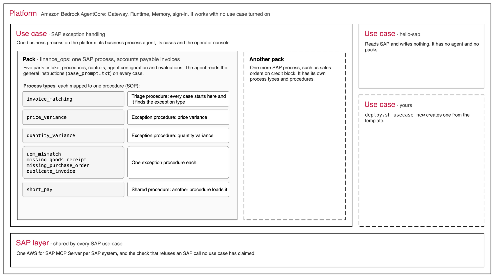
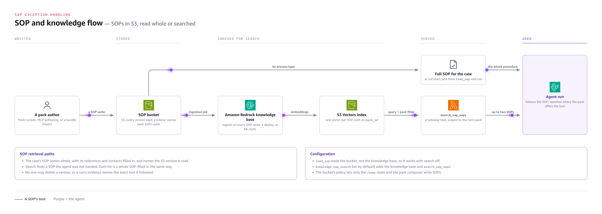

<!--
Copyright Amazon.com, Inc. or its affiliates. All Rights Reserved.
SPDX-License-Identifier: Apache-2.0
-->

# Packs and SOPs

Terms are defined in the [glossary](glossary.md) and in [Concepts](../../../docs/start/concepts.md).

A pack contains everything for one SAP process. For each kind of exception in it, the business
process agent follows a written standard operating procedure (SOP), not a prompt alone. After
this paragraph, these pages say "procedure". Procedures use the RFC 2119 words MUST, SHOULD and
MAY. This pattern is called Agentic SOPs. This page describes what the deployed stack does with
packs. The `dev-new-sap-process`, `dev-author-pack` and `owner-author-sop` skills under
`skills/` guide a coding agent to create and revise packs.

| Page | Covers |
|---|---|
| This page | Pack parts, pack files, authoring, rehearsal, moving a pack between stacks, its status |
| [Roles](roles.md) | Who owns each part, and which group grants each role today |
| [Pack import at deploy](packs/deploy-import.md) | What a deploy does with `packs/` in each stack, and checkout conflicts |
| [Edit rights](packs/edit-rights.md) | Content versus structure, who may change each, versions and SOP writes |
| [SOP-cited values](packs/sop-values.md) | Where each `{{SYMBOL}}` that a procedure cites is kept, and who changes it |
| [Pack promotion](packs/promotion.md) | Import order, version chains, import checks, upgrading |
| [Pack status](packs/status.md) | Every fact `ops pack status` prints, and refusal records |
| [Gateway tools](packs/gateway-tools.md) | Adding a Gateway tool to this use case |

## Pack parts

A pack's contents fall into five parts, grouped by who changes them and how often. All five are
versioned together and move together, so a deployment always runs a set that was tested as one.
The [roles](roles.md) page says which group grants each owner's access.

| Part | What it contains | In the files | Owner | Changes |
|---|---|---|---|---|
| **Intake** | Which SAP documents become cases, the key that names each case, the fields a case shows, the SAP system and entities the agent reads, and the one document it may write | `source`, `fields`, `case_document_check`, `sap_service`, `sap_system` | SAP functional consultant and AI engineer, with the process owner | When SAP or the process changes |
| **Procedures** | The general instructions, the procedures, the rules they cite, and the outcomes a case may close with | `display_name`, `description`, `base_prompt.txt`, `sops/`, `process_type_to_sop`, `shared_sops`, `constants` except the two limits, `dispositions` | Process owner and process analysts | Weekly to monthly |
| **Controls** | The write limits, who works the cases and who approves, the write guards (checks that read SAP again before a payment write) and the verifier (a second model that must agree before a payment write) | `AUTO_WRITE_LIMIT_USD`, `DUAL_APPROVAL_LIMIT_USD`, `entitlement`, `write_guards`, `verifier`, `write_amount_field`, `write_limit_waiver` | Control owner | Yearly, or after an audit |
| **Agent configuration** | The model tier, the turn and spend budgets, the effort, and the Gateway tools the agent may call | `model_tier`, `max_turns`, `run_budget`, `model_effort`, `context_editing`, `gateway_tools`, `verifier.model_tier` | AI engineer | When cost is tuned or a tool is added |
| **Evaluations** | Example cases with the outcome each must reach, and the recipe that seeds an exception in a sandbox SAP system | `evals.json`, `seed` | Process analysts, with the AI engineer | With each procedure change |

Edit rights follow the split between content and structure, not the parts. In Procedures, these
are content: the procedure text, the general instructions, the name, the description and a
rule's value. The `process_type_to_sop` mapping, `shared_sops` and the outcomes are structure,
which needs `business-operations-pack-admins` ([Edit rights](packs/edit-rights.md)).

### Kinds of SOP

Every entry in `process_type_to_sop` is a process type. With the general instructions,
`finance_ops` has four kinds of instruction text. Only shared procedures are marked, in the
pack's `shared_sops`. The kind of every other entry follows from the files. `GET /registry`
lists each entry with its kind (`sops`). The
CDK synth (the step that turns the AWS Cloud Development Kit code into templates) and every
import check `shared_sops`.

| Kind | What it does | In `finance_ops` |
|---|---|---|
| **General instructions** | Read on every case of the pack, around whichever procedure applies | `base_prompt.txt` |
| **Triage procedure** | The procedure every case starts with (`source.process_type.default`). It identifies the exception type, then loads that type's procedure with `load_sop`. Another process type mapped to the same file is an alias of it | `invoice_matching.txt`, which `invoice_matching` maps to and its aliases `three_way_match` and `ap_exception` too |
| **Exception procedures** | One per exception type: how to resolve it | Price variance, quantity variance, unit of measure mismatch, missing goods receipt, missing purchase order, duplicate invoice |
| **Shared procedures** | Loaded from another procedure, never chosen by triage, and named in `shared_sops` | `short_pay.txt`, which the price and quantity variance procedures load after an approver chooses a short payment |

The triage procedure is the default process type because the poller cannot tell the exception
type from the blocked invoice alone. A price variance and a missing goods receipt can look the
same at first. The agent must compare the invoice with the purchase order and the goods receipt
to tell them apart, and the triage procedure makes that comparison.

A case keeps the process type it was created with in `process_type`. The exception type that the
agent identified is the case's `exception_type`. The runtime records it with the run's trace. It
is the last exception procedure the run was given, whether the run was routed to it or `load_sop`
served it. An alias is recorded as the type it stands for. A triage or shared procedure is never
recorded, so a case that has not been classified yet has no exception type. In `finance_ops`,
`exception_type` is a different field from the SAP block reason (`sap_block_reason`, SAP's
`PaymentBlockingReason` code), which says why SAP blocked the invoice.

### Rules, limits and contacts

A procedure cites three kinds of value by name ([SOP-cited values](packs/sop-values.md)):

- **Rules**, such as `{{PRICE_VARIANCE_PCT}}`, belong to Procedures. A rule has the same value in
  every deployment that the pack version reaches. Code also checks some rules. In `finance_ops`:
  - the `within_tolerance_or_approved` write guard reads the price and quantity tolerances and
    `LINE_AMOUNT_TOLERANCE_USD`;
  - the `no_duplicate` write guard reads `DUPLICATE_MATCH_WINDOW_USD`.

  A change to one of those six rules changes what the agent may post without an approval, so
  agree it with the control owner. `GET /packs/{pack_id}/rules` and `ops pack status` name the
  write guards that read each rule (`guarded_by`;
  [Guarded rules](packs/sop-values.md#guarded-rules)).
- **Limits**, `AUTO_WRITE_LIMIT_USD` and `DUAL_APPROVAL_LIMIT_USD`, belong to Controls. The pack
  sets the upper limit. A deployment may set a lower value.
- **Contacts**, such as `{{CONTACT_AP_TEAM}}`, name a role. Each deployment sets the address.

### Deployment settings

These are set per deployment, take effect at once, and are not versioned with the pack:

| Setting | Where | Owner |
|---|---|---|
| Contact addresses | `use_cases.business-operations.contacts` in `platform.yaml`, then `PUT /deployment/settings` | Operator |
| A limit lowered below the pack's | `PUT /packs/{pack_id}/controls` | Operator |
| Trigger mode, one for the deployment and one for each pack. A case is queued without a person starting it only when both are `auto`. A pack with no trigger mode set is `manual` | `PUT /deployment/trigger-mode`, `PUT /packs/{pack_id}/trigger-mode` for a pack, or `ops.py trigger-mode set [--pack <pack_id>]` | Operator |
| The active pack version | `ops bundle import`, with a change reference outside development | Operator |
| Who is in each group | The identity provider's group mapping | Identity administrator |

There are two trigger-mode settings for two reasons. The deployment setting stops all
unattended runs in one place. The pack setting lets one pack run on `auto` while a new pack
stays `manual`.

## Pack files



What each file contains, and who may change it in development. Content needs the pack's
`entitlement.author_groups`; structure needs `business-operations-pack-admins`
([Edit rights](packs/edit-rights.md)). Outside development nobody edits these files. A
published version arrives there by `bundle import`.

```text
packs/finance_ops/
├── pack.json                  structure (pack admin): source, fields, case_document_check,
│                              process_type_to_sop, shared_sops, dispositions, entitlement,
│                              write_guards, verifier, model_tier, max_turns, gateway_tools,
│                              the two write limits, and which rules exist
│                              content (pack author): display_name, description, and rule
│                              values (these also need the pack's constant_groups)
├── base_prompt.txt            content (pack author): the general instructions
├── evals.json                 evaluations (pack author, in the console): example cases
└── sops/                      content (pack author): the procedure text;
    │                          adding or removing a file is structure (pack admin)
    ├── invoice_matching.txt   triage procedure
    ├── price_variance.txt     exception procedure, one of six
    ├── ...
    └── short_pay.txt          shared procedure
```

Deployment settings are not in these files. The operator sets contact addresses, a lowered
limit, the trigger mode and the active version per deployment
([Deployment settings](#deployment-settings)).

A pack lives in `packs/<pack_id>/`:

- `pack.json`: the agent configuration, its SAP `source` and its `fields`. `packs/pack.schema.json` is
  authoritative for it.
- `base_prompt.txt`: the pack's base prompt, its general instructions.
- `sops/`: the triage, exception and shared procedures.
- `evals.json`: the example cases that the evaluation runs check. In development the pack's
  authors can also change them in the console, one case at a time. Each change is a version
  ([Evaluation runs](operating/evals.md#results-in-the-console)).

## Changes that need a deploy

After a stack's first deploy, no pack change needs a deploy. Packs change through the console,
REST, MCP (Model Context Protocol) or `bundle import`. In development, a deploy also imports any
checkout pack that changed since the last deploy. The deploy fails if the same pack was also
edited in the console. Quality and production take a pack only by `bundle import`. For the
details, and how to resolve a conflict, see [Pack import at deploy](packs/deploy-import.md).

## Authoring in the console or an MCP client

Edits happen in development only. Quality and production stacks refuse every pack and procedure
write over HTTP.

- **Content** (the prompt, procedure text, display name, description, and a declared constant's value)
  needs `business-operations-authors`, plus the pack's `author_groups` when it sets any. A
  constant's value also needs the pack's `entitlement.constant_groups`.
- **Structure** (every other key, and the write limits) needs `business-operations-pack-admins`.
- **Every edit is a version**, with its author recorded. `ops bundle versions` lists them, and
  `ops bundle rollback` returns to any of them.
- **A saved procedure takes effect at once.** The next run reads it, and procedure search indexes
  it automatically.

For the exact rules, and what a created pack may do, see [Edit rights](packs/edit-rights.md).
For where each value that a procedure cites is kept, see [SOP-cited values](packs/sop-values.md).



([Animated version](diagrams/knowledge-flow.gif))

## Pack rehearsal

A rehearsal runs a pack's prompt and procedures against a case that the author describes, before
the pack works any real case. It is the only way to try out an incomplete pack.

1. On a pack's Overview or Procedures tab, or on a procedure, press **Rehearse** (open to the
   pack's authors).
2. Pick the procedure. Optionally, start from one of the pack's example cases. Describe the case
   the way the exception would arrive.
3. The run's steps show on the Rehearse page. The agent reads what it needs and follows the
   procedure to the decision. It then says what it would post: the entity, the fields and the
   values. If you started from an example case, **Save as example case** keeps it in the pack's
   evaluations, with its seed inputs and the outcome it must reach. A case described in words
   has no seed inputs for the evaluation run to post, so it cannot be saved as an example case.

What the code does:

- The console sends `POST /runs` with `rehearse: true`, a `process_type`, a prompt and a session
  id, and no case.
- The route refuses a `case_id` beside `rehearse`. It finds the pack from the process type
  (incomplete packs included). The caller must be in `business-operations-authors` and, when the
  pack sets `author_groups`, in one of them.
- The runtime adds a note saying that this is a rehearsal. It does not offer any tool that
  changes data (SAP writes, `update_case_state`, `demo_create_ticket`, `send_notification`).
- The run grant includes `rehearsal`, and with it the run checks refuse the same tools.
- With no case, nothing is written to a case row.
- The transcript is not stored. It goes only to the run channel (the live stream to the
  console), which is why the authoring MCP server offers no rehearsal.

## Promotion between stacks

A pack moves as a **bundle**: one JSON file that contains its `pack.json`, `base_prompt.txt` and
procedures, with a `sha256` checksum over them. The move works much like an SAP transport from
development to quality to production ([Pack promotion](packs/promotion.md)). Each stack has one
`promotion.role`:

```yaml
use_cases:
  business-operations:
    promotion:
      role: quality   # unset: production under deployment.mode: production, else development
```

| Role | Creates versions | Edits over HTTP (`PATCH /packs/{pack_id}`, its procedures and example cases) | Change reference |
|---|---|---|---|
| `development` | Yes, on every edit, and on importing a draft; `export` publishes the active version | Content and procedures by the pack's authors, structure by `business-operations-pack-admins` | Optional |
| `quality`, `production` | No: imports sealed bundles only | Refused: content, procedures and structure all arrive by import | Required, at most 128 characters |

Outside development, nobody edits a pack in place. A fix is an edit in development, then an
`export`, then an import into each stack with a change reference. Two routes are current
settings, not edits, and work in every stack:

- `PUT /deployment/settings` (contacts);
- `PUT /packs/{pack_id}/controls` (write limits lowered below the pack's value).

```bash
ops() { ./scripts/deploy.sh usecase run business-operations "$@"; }
ops bundle export finance_ops -o finance_ops.json        # DEV: publishes the active version
ops bundle import finance_ops.json --change-ref CHG0042  # dry run: the checks and the diff
ops bundle import finance_ops.json --change-ref CHG0042 --apply
ops bundle import packs/finance_ops                      # DEV: a checkout dir is a draft
ops bundle export my_draft --to-dir use-cases/business-operations/packs  # an incomplete draft, to complete
ops pack status                                          # every pack, one line each
ops bundle versions finance_ops                          # stored versions and the audit trail
ops bundle rollback finance_ops --to 3 --apply           # re-import a version stored here
ops bundle retire finance_ops --apply                    # DEV: a version that removes the pack, which imports too
```

For what an import checks, how versions form a chain, and how to upgrade a stack that took
edits in place, see [Pack promotion](packs/promotion.md).

## Pack state

`ops pack status` prints one line per pack. `ops pack status <pack_id>` prints one pack's facts,
one per line. The command only reads.

```text
finance_ops: v4 from import 2026-11-10T09:30 by arn:aws:sts::111111111111:assumed-role/Deployer/ana (CHG0042); routes price_variance, qty_variance; checkout matches; search current; trigger mode auto (deployment manual); no refusals
```

For what each fact means, see [Pack status](packs/status.md). The console shows the version on
the packs index, and the version and last refusal on each pack's Overview.

## Gateway tools

A new tool needs four changes: the target and its function, the tool list that packs are checked
against, a Cedar permit, and the pack's `gateway_tools`. Then decide whether the run checks must
know about the tool. For the steps, see [Gateway tools](packs/gateway-tools.md).
