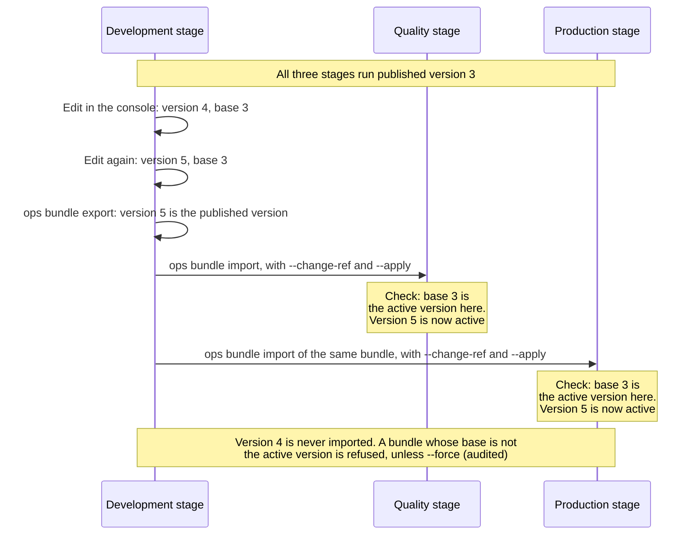

<!--
Copyright Amazon.com, Inc. or its affiliates. All Rights Reserved.
SPDX-License-Identifier: Apache-2.0
-->

# Pack promotion

How a bundle moves between stacks, and what an import checks. The promotion roles and the
`ops bundle` commands are in [Packs and SOPs](../packs.md#promotion-between-stacks). A standard
operating procedure (SOP) is called a procedure below.

## Promotion path

A pack moves like an SAP transport. Development is the only stage where it is edited. `export`
is like releasing the transport request. It makes the active version the published version, and
writes that version to a bundle file. An import into quality, and then into production, is like
importing the transport, and needs a change reference. Each stage is its own deployment, with its
own SAP system (`promotion.role`).

An import is a dry run until you add `--apply`. The code for each value: `base` and `previous`
are in `api/layer/python/bundle.py`, and the import checks are in `pack_composer/index.py`.

## Edits outside development

Outside development, nobody edits a pack in place. A prompt fix or a procedure correction is an
edit in development, then an `export`, then an import into each stack with a change reference. So
every change that a quality or production stack runs has a version and an audit record.

`PUT /deployment/settings` (contacts) and `PUT /packs/{pack_id}/controls` (write limits lowered
below the pack's value) are current settings, not edits. They work in every stack.

## Import order

An import writes the procedures that changed, then the pack documents, then `registry.json`. If
a write fails, it restores everything it wrote.

## Version chains

Versions form a chain over published versions. Each version that development creates records
`base`: the version that `export` last published there. Only a published version moves to another
stage, so the edits between two published versions never need to be imported on their own.

An import refuses a bundle whose `base` is not this stack's active version. (For a bundle exported
before publishing existed, the check uses `previous`.) The check makes sure the bundle was built
on the version that the stage runs now. So an import never replaces a version that the bundle did
not start from. For example, it refuses the bundle when the stage was rolled back to an older
version, or when a later version arrives before an earlier one. `--force` skips the chain check and
is audited. A stack with no version of the pack has nothing to differ
from. So a new quality or production stack takes any sealed version as its first import, without
`--force`.

## Import checks

An import also refuses:

- a group the bundle names that the pool lacks (`ops add-group` creates it);
- a tool or model tier the stack does not offer;
- a procedure that cites an undeclared constant;
- a process type another pack owns.

Bundles are not signed. The `sha256` checksum detects corruption, not a deliberate edit. An
import does not check who reviewed the published version, and does not check a signature. Your
release pipeline adds both
([production checklist](../production-checklist.md#authorization-and-autonomy)).

## Bundle storage

Bundles, the active pointer and one audit record per verb are stored in the registry bucket under
`_bundles/` and `_audit/`; the last published version is `_bundles/<pack_id>/released.json`.

## Upgrading a stack that took edits in place

Earlier releases of this repository let a quality or production stack edit content and mapped
procedures in place. In such a stack, the deploy of this release fails while any pack's deployed
files differ from its active version. The deploy names each pack and file, and rolls back without
writing anything.

Before you deploy this release, move each edit into development with the previous release's
checkout, which still has `bundle pull` (this release removed it):

1. `ops bundle status <pack_id>` lists the files.
2. `ops bundle export <pack_id> -o <file>` in that stack.
3. `ops bundle pull <pack_id> --from-file <file> --apply` in development.
4. Export from development and import with a change reference.

To discard the edits instead, run
`ops bundle rollback <pack_id> --to <active version> --change-ref <ref> --apply` there.

In a development stack, the same deploy stores any such edits as the next version, named
`adopted edits`.
