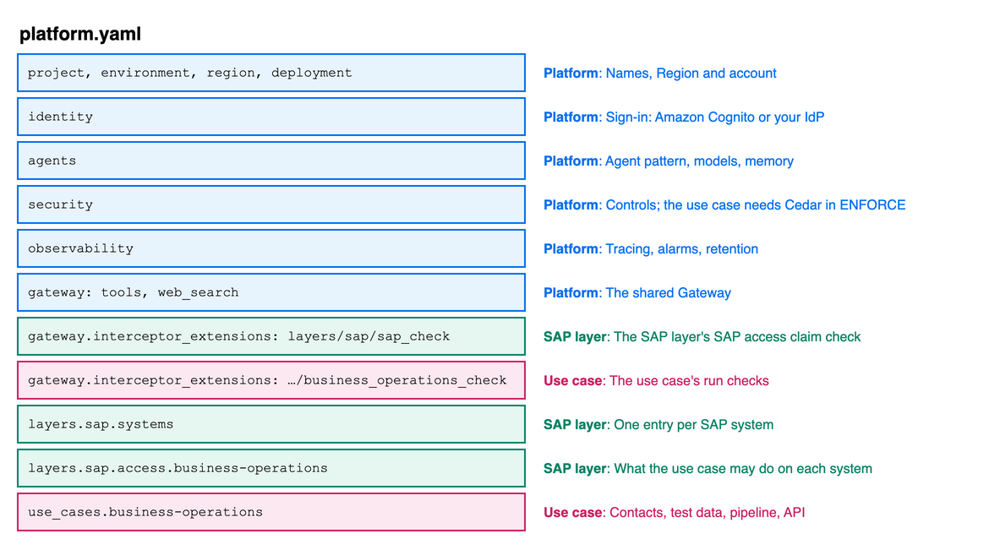
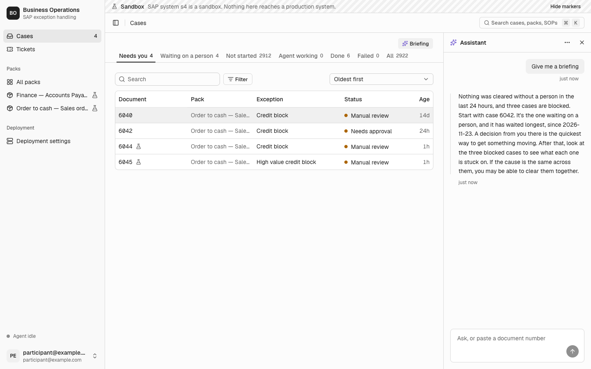
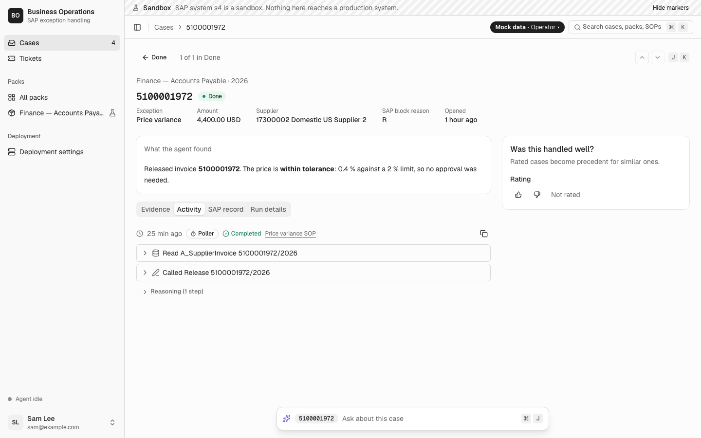

# Quickstart

This page deploys the platform, the SAP layer and SAP exception handling into one AWS account,
connects one SAP system, and takes one exception through the business process agent. Each
step is one action, and each checkpoint says what you just proved. The
[platform quickstart](../../../docs/start/quickstart.md) is the same path for any use case.

> **Prefer to have an assistant do it?** Open the repository in an AI coding assistant that
> reads skills (such as Claude Code or Kiro) and ask it to "deploy this and connect it to SAP".
> The `cloud-deploy-and-wire` skill runs these same steps and asks you before it deploys. You
> type the SAP password yourself.

> **Before you connect to SAP**, review the
> [SAP API Policy](https://help.sap.com/doc/sap-api-policy/latest/en-US/API_Policy_latest.pdf) and
> your agreements with SAP. This is sample code. Use a sandbox SAP client, because the test data
> that it posts creates real SAP documents.

## Prerequisites

| | |
|---|---|
| **AWS account** | Credentials that can create AWS Identity and Access Management (IAM) roles, Amazon Cognito, AWS Lambda, Amazon DynamoDB, Amazon S3, Amazon CloudFront, Amazon API Gateway, AWS AppSync, Amazon SQS, Amazon EventBridge, Amazon ECR, AWS CodeBuild and Amazon Bedrock AgentCore resources |
| **Region** | One where Amazon Bedrock AgentCore and your models are available |
| **Lambda concurrency** | An account quota of more than 100 concurrent executions in the Region (the usual default is 1,000). The stack reserves concurrency for some functions, and Lambda refuses a reservation that leaves less than 100 unreserved. A new account can start with a quota of 10, and then the deploy fails. Check with `aws lambda get-account-settings --query AccountLimit.ConcurrentExecutions`, and request an increase in Service Quotas if it is lower |
| **Model access** | In the Amazon Bedrock console for that Region: the Anthropic Claude Sonnet and Haiku models the platform uses, and **Amazon Titan Text Embeddings V2** (search over the standard operating procedures, or SOPs) |
| **Your machine** | Python 3.13, Node.js 20.19+, 22.12+ or 24 with npm, AWS CLI v2, bash 4 or newer (macOS ships 3.2: `brew install bash`), git |
| **SAP** | A **sandbox** client of SAP S/4HANA, with:<br>- SAP's S/4HANA sample data (company code `1710`; without it, step 8 says what to do)<br>- the four OData (Open Data Protocol) services that the shipped pack uses, active<br>- a System service user<br>- an HTTPS endpoint that AWS can reach, with a certificate from a publicly trusted certificate authority (CA)<br>- an open posting period (an accounting period in which SAP accepts postings).<br>Your SAP team's checklist: [SAP setup prerequisites](../../../layers/sap/sap-setup.md#prerequisite-decisions) |
| **People** | Your email address for the first console user, and someone in your SAP team on call |

Other setups work too: ECC, a service that is not published yet, SAP sending events, single
sign-on to SAP, and Microsoft Entra ID. Each of them needs work from someone in SAP or in your
identity provider. Start with this one.

## 1. Get the code

```bash
git clone <this repository's URL> && cd <its folder>
python3.13 -m venv .venv && source .venv/bin/activate
pip install -r requirements.txt
```

## 2. Check the API Gateway logging role

```bash
aws apigateway get-account --query cloudwatchRoleArn
```

If it prints `null` or `None`, Amazon API Gateway in this account and Region has no Amazon
CloudWatch role yet. In step 3, uncomment the `api:` line at the end of the file. Set it in one stack per
account and Region only.

## 3. Write `platform.yaml`

```bash
cp use-cases/business-operations/quickstart.platform.yaml platform.yaml
```



Open `platform.yaml` and replace each value marked `CHANGE`:

- the project name, environment and Region
- your AWS account id
- your SAP host and client
- the contacts that the procedures send messages to

Leave the system key `s4` as it is.

```bash
./scripts/deploy.sh design     # checks the file and prints the stacks it will create
./scripts/deploy.sh doctor     # checks your tools, account, Region and model; changes nothing
```

> **Checkpoint: the design is valid.** *You proved:* your configuration loads, and your machine
> and account are ready. *Why it matters:* the deploy stops on the same checks, but later and
> more slowly. *If not:* fix every `[FAIL]` that `doctor` prints, then run both again.

## 4. Store the SAP password

```bash
./scripts/deploy.sh layer run sap secrets s4
```

Type the SAP user and password at the prompt. They go to AWS Secrets Manager and never into a
file.

> **Checkpoint: the SAP secret exists.** *You proved:* the credentials are stored where the
> SAP layer reads them. *Why it matters:* the AWS for SAP Model Context Protocol (MCP) Server
> checks the secret when it starts. *If not:* run the command again. It stores a new version.

## 5. Deploy

```bash
./scripts/deploy.sh deploy
```

It shows the account, Region and stacks, and asks before it creates anything. The first deploy
takes the longest. Its summary lists the outputs of each stack. Note `ConsoleUrl`, the address
of the operator console.

> **Checkpoint: the stacks are up.** *You proved:* the platform, the SAP layer and the use case
> deployed. *If not:* [Troubleshooting](../../../docs/TROUBLESHOOTING.md) is organized by symptom.

## 6. Verify

```bash
./scripts/deploy.sh verify
```

Each check prints `PASS:` or `OK:` lines. The use case's lines start with `OK: reader lists`.
The last line is `OK: all <n> checks passed for this footprint`. The footprint is the set of
stacks that this deployment contains.

> **Checkpoint: the controls refuse what they should.** *You proved:* the agent's tools are
> reachable, a call with no run grant is refused, Cedar refuses the read-only client's write,
> and the agent runtime is ready. *Why it matters:* this is the evidence that the guardrails are on, not
> only configured. *If not:* the `FAIL:` line names the cause.

## 7. Create a console user and sign in

```bash
./scripts/deploy.sh usecase run business-operations add-user <your-email> --create --admin --author --case-worker --pack-admin --groups business-operations-ap-manager
```

Amazon Cognito emails you a temporary password. Open the `ConsoleUrl`, sign in, and set a new
password. `business-operations-ap-manager` lets you approve the shipped pack's writes.
`--case-worker` lets you start the agent on a case.

> **Checkpoint: the agent answers.** On **Cases**, press **Briefing**. The agent summarizes the
> queue in the assistant panel.
> *You proved:* sign-in works and the console reaches the agent.



## 8. Create a case

```bash
./scripts/deploy.sh usecase run business-operations seed finance_ops --preset 1 --yes
./scripts/deploy.sh usecase run business-operations poll finance_ops
```

The first command posts a matched purchase order, goods receipt and invoice into the sandbox,
with the invoice blocked for payment. It prints the `SupplierInvoice` number and the `case_id`.
The second command asks SAP for exceptions now, instead of waiting for the schedule.

The poll makes a case for **every** open exception that the pack finds in SAP, not only yours.
In a sandbox that others have used, that can be thousands of cases. Nothing runs until someone
starts it, so these cases cost nothing. To find yours, search **Cases** for its invoice number,
or open `<ConsoleUrl>/cases/<case_id>`.

If the seed fails with an error that names `posting_date`, the posting period is closed. Ask
your SAP team which period is open, and add `posting_date=<YYYY-MM-DD>` to the first command.

The seed posts on SAP's S/4HANA sample data:

- supplier `USSU-VSF04`
- material `MZ-RM-R300-01`
- plant, purchasing organization and company code `1710`
- purchasing group `002`

If your client has no sample data, SAP refuses the purchase order. In that case, skip the
seed. Ask your SAP team to post one supplier invoice with a payment block in the sandbox
(transaction MIRO), then run only the poll.

> **Checkpoint: SAP reaches the case store.** The case appears in the console as `detected`.
> *You proved:* the poller reads SAP and turns an exception into a case.

## 9. Run the agent

Open the case and press **Process**. The case page shows each step while the agent works,
usually for a minute or two. The agent loads the procedure, reads the invoice, order and
receipt from SAP, and decides. For the seeded invoice, it releases the payment block and closes
the case as `complete`, with the disposition `released`. A change above the pack's limit would
instead wait for an approver, who sees the exact difference. The case would then be in
`awaiting_human_input`.



> **Checkpoint: one case, end to end.** *You proved:* the agent follows the procedure against
> real SAP data, and the controls decide whether its change posts. The case record shows each
> step, the SAP data the agent read and the procedure version it followed.

## 10. Edit and rehearse an SOP

On the **Packs** screen, open `finance_ops`, edit one of its procedures, and save it. Then press
**Rehearse** and describe a case. The agent works the case with the saved procedure and says
what it would post. A rehearsal changes nothing in SAP. The next real run also uses the saved
procedure.

> **Checkpoint: no redeploy.** *You proved:* a process owner changes the agent's behavior by
> editing its procedure. *Why it matters:* the rules are in a document that your team owns, not
> in code. Make such changes in a development deployment first
> ([for process owners](for-process-owners.md)).

New cases wait for you, because the trigger mode starts as `manual` for the deployment and for
each pack. If you switch both to `auto`, every open exception that SAP shows for that pack is
queued, and you pay for each run. Do that only when you trust the pack.

## Scripted run

For lab provisioning or a pipeline, run steps 3 to 7 with no prompts. With `NON_INTERACTIVE=1`,
`deploy.sh` and every `usecase run` verb that normally asks first continue without asking. This
is the same as passing `--yes` to each one. Set it only where those answers are already
decided.

1. **`platform.yaml`:** write it from the quickstart's file, with every value marked `CHANGE`
   taken from your variables, for example:

   ```bash
   python3 - <<'EOF'
   import os, yaml
   c = yaml.safe_load(open("use-cases/business-operations/quickstart.platform.yaml"))
   c.update(project=os.environ["PROJECT"], environment=os.environ["ENV"],
            region=os.environ["REGION"])
   c["deployment"]["platform_account"] = os.environ["ACCOUNT"]
   s4 = c["layers"]["sap"]["systems"]["s4"]
   s4.update(base_url=os.environ["SAP_BASE_URL"], client=os.environ["SAP_CLIENT"],
             secret_name=os.environ["SAP_SECRET_NAME"])
   c["use_cases"]["business-operations"]["contacts"] = {
       k: os.environ["CONTACT_EMAIL"]
       for k in ("ap_team", "finance_approvals", "procurement", "warehouse")}
   yaml.safe_dump(c, open("platform.yaml", "w"), sort_keys=False)
   EOF
   ```

2. **The SAP secret:** `layer run sap secrets` reads only from a terminal, on purpose. Instead,
   point `secret_name` at a secret that already exists in the deployment's Region. The secret is
   a JSON object: `{"username": "...", "password": "..."}`. Several lab stacks in one account can
   name the same sandbox secret. If your provisioning creates the secret, take the value from the
   provisioning's own secret store. Never take it from a command-line argument or from a file
   that the provisioning leaves behind.
3. **Deploy:** `NON_INTERACTIVE=1 ./scripts/deploy.sh deploy > deploy.log 2>&1`, then check the
   log as step 5 says. If a deploy was stopped or lost its connection, it leaves a lock, and the
   next deploy refuses to start:
   [Another deployment holds the lock](../../../docs/TROUBLESHOOTING.md#another-deployment-holds-the-lock).
4. **Users:** `NON_INTERACTIVE=1 ./scripts/deploy.sh usecase run business-operations add-user
   <email> --create --admin --author --groups business-operations-ap-clerk` for each person.
   A user who is in none of a pack's groups cannot load the console. Use
   `business-operations-ap-manager` instead only for the people who approve the shipped pack's
   SAP writes. Under `NON_INTERACTIVE`, `--pack-admin` is granted without its usual question.
   Add it only for the people who should change the structure of every pack. Amazon Cognito
   emails each person a temporary password.
5. **Verify:** `./scripts/deploy.sh verify` exits non-zero on any failure.

For a lab on a shared sandbox, also set `use_cases.business-operations.pipeline.poll_created_since`
to the lab's first day. Each stack's first poll then makes cases only for documents posted from
that day on, not for the sandbox's whole backlog. On one shared SAP client, those documents
include the seeded documents of every participant, so each stack also sees the cases of the
others.

To remove a lab, run `NON_INTERACTIVE=1 ./scripts/deploy.sh destroy`. It removes the stacks. It
reports, but keeps, the log groups, the secrets that `deploy.sh` created itself, and any bucket
that is not empty. `--yes` deletes those too. It never deletes the SAP secret, so a shared
secret stays in place.

## Clean up

```bash
./scripts/deploy.sh destroy
```

Close the console first. What to remove beyond the stacks (the SAP secret, retained data, the
SAP side), and what to do if the destroy stops on a bucket:
[Deployment removal](operating/removal.md#deployment-removal).

## Next steps

- [Pages by role](roles.md#pages-by-role) for this use case's roles, and
  [Next steps](../../../docs/start/next-steps.md) for the platform and SAP roles.
- Every setting on this page: the [use case walkthrough](../walkthrough.md).
