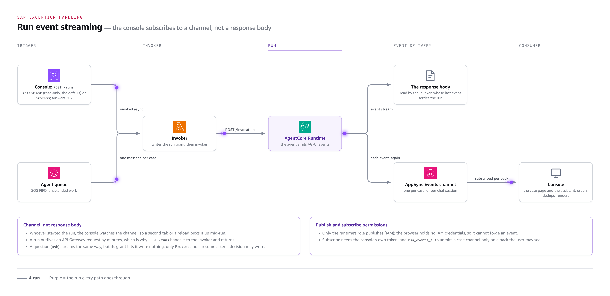

<!--
Copyright Amazon.com, Inc. or its affiliates. All Rights Reserved.
SPDX-License-Identifier: Apache-2.0
-->

# Runtime reference

For the engineer changing `api/runs/`, `invoker/`, `agent/utils/run_channel.py`,
`run_events_auth/` or `packages/run-client/`. The adopter view is in
[Lifecycle](../lifecycle.md).

## Path of a run



([Animated version](../diagrams/run-streaming.gif))

```
Who starts it                       Who reads the response body
Console: POST /runs                 the invoker, which drains it and logs the terminal event
  claims the case's live_run,
  invokes the invoker async,
  answers 202 {run_id, session_id, intent}
The agent queue (SQS FIFO)          the invoker, the same way
              |
              v
AgentCore Runtime (protocol AGUI): POST /invocations <- RunAgentInput
  ag_ui_strands wraps the Strands agent
  -> a stream of AG-UI events, to the invoker
  -> each event also published to the run's AppSync Events channel
              |
              v
Console: subscribes per pack, RunFollower orders and dedups, the reducer projects,
the transcript store renders it
```

The console never reads a response body. It watches the channel instead. Every caller sends the
same `RunAgentInput`, and this use case's fields are in `forwardedProps.erpPayload`. The
runtime's authorizer accepts only the delegating client, and only the run route and the invoker
have that client.

## Starting and stopping

| Route | Effect |
|---|---|
| `POST /runs` | Checks the caller may start this kind of run, claims `live_run` on a case, then invokes the invoker asynchronously. `202 {run_id, session_id, intent}` |
| `POST /runs/stop` | Ends the Runtime session, then releases the `live_run` claim. `202 {stopped}`. `stopped` is false when the Runtime refused, so the case will show as busy again |

A start's `intent` decides whether the run may write ([Asking and processing](#asking-and-processing)).

What a caller should handle on a start:

- **`409 {error: "already_running", run_id}`**: a run already has this case. Watch that `run_id`
  instead of retrying. This answer is also what makes a double-click harmless.
- **`409 {error, status}`** on Process: the case is settled (`complete` or `sap_updated`), so
  Process does not run on it again. The claim's own condition refuses it, and nothing is claimed.
  A question on the same case still starts.
- **`400`**: one of these:
  - no prompt, or a prompt over 32 KB;
  - a `case_id` that cannot be parsed;
  - with no case, a `session_id` shorter than the Runtime's minimum, or inside the `erp-case-`
    namespace that case session ids use. This one is refused because a caller who could name a
    case's session id would run inside that case's Memory session, without taking its
    `live_run` claim.
- **`403`**: not entitled to the pack, or not one of its approvers.
- **`404`**: no such case.
- **`502`**: the hand-off to the invoker failed. The `live_run` claim is released first.
- **`503`**: the invoker is not configured.

The route writes `visible_packs` (the packs the caller is entitled to) into the invocation. It
never takes that value from the client. The runtime drops any `process_type` outside it. So a
chat turn that names another pack's case in its text does not get that pack's standard operating
procedure (SOP), called "procedure" below. A rehearsal (`rehearse: true`) is authorized here too
([Packs](../packs.md#pack-rehearsal)).

### Asking and processing

A conversation turn cannot write; only Process and the resume after a person's decision or
reply can.

| Start | `intent` | Needs | May write |
|---|---|---|---|
| A message in the assistant, on a case or off one; the briefing | `ask`, the default when absent | Access to see the case's pack, or any pack when there is no case | No |
| Process on a case | `process` | A `case_id`, `business-operations-case-workers` and the pack's `process_groups` where it sets them | Yes, within the run checks |
| Rehearse | none, `rehearse: true` | The pack's author grant | No |
| The agent queue: the poller, SAP push, the sweeper, `rerun`, the console's enqueue, the resume after a decision, a reply or a ticket | none | What queued it | Yes, within the run checks |

For a question, the invoker writes `ask` on the run's grant. The run checks then refuse every
SAP write, `update_case_state`, `demo_create_ticket` and `send_notification` on that grant, as
they do for a rehearsal. The invoker reads any direct start without `intent: "process"` as a
question, so a caller that sends nothing new cannot write.

The agent is told that it is answering a question, and is given no tool that changes data. When
asked to act, it says where the person does it: Process on the case, or the case's decision. A
question on a case still does these things, marked `intent: "ask"`:

- it routes to the case's procedure;
- it takes the case's `live_run`;
- it runs in the case's Runtime session;
- it appends its trace.

It records no `exception_type`, and does not flag the case for review when its procedure fails
to load. The `400` answers are `intent must be "ask" or "process"`, `Process needs a case_id`,
and `A rehearsal is not a process run`.

While a run streams, it writes a `live_run` snapshot onto its case, at a limited rate. The
snapshot is the `live_run` claim plus the last part of the turn, limited in size. Opening a case during a
run shows the snapshot at once, and every screen reads it to know the case is busy. A snapshot older than `LIVE_RUN_STALE_SECONDS` (60, generated from
`types/`) is read as an interrupted run and ignored.

## AG-UI events

The runtime is configured with protocol `AGUI` (`business_operations/runtime.py`), and
`ag_ui_strands` emits canonical AG-UI events, so a client consumes a stable contract rather than a
parser for one framework. The reducer (`packages/run-client/src/reducer.ts`) is a pure function
of the event sequence:

| Event | Effect on the projection |
|-------|--------------------------|
| `RUN_STARTED` | None |
| `TEXT_MESSAGE_START` / `_CONTENT` | Ensures an assistant message, appends the delta |
| `TOOL_CALL_START` / `_ARGS` / `_END` | Adds a tool call, appends its input, moves it to `executing` |
| `TOOL_CALL_RESULT` | Records the result, marks it `complete` |
| `MESSAGES_SNAPSHOT` | Replaces message content and tool calls from the snapshot |
| `RUN_FINISHED` | Settles unresolved tool calls |
| `RUN_ERROR` | Settles them and appends an error message |

AG-UI has no cancelled event. A deliberate stop, such as reaching `max_turns`, is a `RUN_ERROR`
with a code (`MAX_TURNS_REACHED`), which the console shows as a warning. A run over its pack's
`run_budget` stops the same way, with `RUN_BUDGET_EXCEEDED`.

- **The budget check never interrupts a tool call.** It runs after each model response and
  before the tools the response asked for. Strands answers each requested tool with "Tool
  execution cancelled", and does not call the model again. A closing text response is never
  turned into a stop, because there is nothing left to stop.
- **Three failed tool calls in a row** stop a run with `REPEATED_TOOL_ERRORS`. So when SAP cannot
  be reached, the case is left for a person on its first run, not after three runs. A success
  between failures resets the count.
- **Each Gateway response waits at most 120 seconds.** A tool call that never gets a result is
  settled as `incomplete`, not complete or failed. A call that changes data may have succeeded,
  so the console asks the person to check, and does not invite a retry.
- **`RUN_ERROR` is published after `_sanitized_run_error`** (`agent/utils/stream.py`), so raw
  error text is never sent to a client.

## Keepalive

One SAP OData call can leave the stream idle for minutes. A network hop on the way drops an idle
connection, and that would end the run while the invoker still waits for it. So the agent adds a
server-sent events (SSE) comment to the stream every 15 seconds, plus one when the stream opens:

```
: keepalive 3 45000
```

The fields are a sequence number and elapsed milliseconds, so a disconnect can be matched to the
keepalive that should have followed it. A comment has no `data:` line, so no client sees an event.
`_with_keepalive` (`agent/utils/stream.py`) adds the keepalives from outside the adapter's event
loop. A failure of the event source still reaches the caller, and closing the stream cancels
both. The channel's socket has its own keepalive: AppSync Events sends `ka` about every 60
seconds, and `subscribeRunEvents` reconnects when frames stop.

## The run-event channel

An AppSync Events API in the runtime stack (`business_operations/runtime.py`), namespace `runs`.

| Operation | Provider | Who |
|---|---|---|
| Publish | IAM only | The runtime role (`grant_publish` on the namespace) |
| Connect, subscribe | Cognito user pool, with `appIdClientRegex` set to match only the console client; in direct mode, OpenID Connect (OIDC), with issuer and `aud` = the platform app | The console's own token |
| Subscribe, per channel | `run_events_auth/`, the namespace's `onSubscribe` handler | A Business Operations user, on a pack they may see |

**Channel grammar.** A case run publishes on `/runs/<short_id>/<case_id>`. `<short_id>` is the
pack's short id, the prefix that every one of its case ids starts with. A run with no case (a chat
turn or a rehearsal) publishes on `/runs/<session_id>`, a UUID that the browser created. The console subscribes to
`/runs/<short_id>/*` for each pack it can see and to its own session channel.

**What subscribe admits.** On every subscribe, `run_events_auth/` first requires the API's own
minimum group (`business-operations-users`). Then:

- `/runs/<short_id>/<case_id>` or `/runs/<short_id>/*`: admitted only if the case id starts with
  that short id, and the caller may see the pack the published registry maps it to;
- `/runs/<uuid>`: admitted to any user, because a session channel belongs to no pack and its
  unguessable id is its protection;
- anything else, `/runs/*` and a bare `/runs/<case_id>` included: refused. A registry that cannot
  be read raises an error, so the subscribe fails and is not admitted.

So a signed-in operator watches runs in real time only for the packs they could read through `GET /cases`. The
remaining exposure is the same as the API's. Entitlement separates packs, not one operator's cases
from another's. So anyone entitled to a pack sees every run in it, tool arguments and SAP results
included.

Three more properties follow from the split between publish and subscribe:

- **A subscriber cannot forge an event.** Publish is IAM-only, and the browser has no IAM
  credentials. The channel key does come from the client, though: it is the case or session id
  named when starting the run. So an operator can cause events attributed to the agent on a
  channel they chose. Opening the case gives them the same access, so this gives them nothing new.
- **The agent cannot open a socket.** Its role may publish on one namespace, and nothing else.
- **A machine client cannot subscribe.** Under Cognito, the client-id regex admits only the
  console client. That is why the subscriber presents its id token: the access token's `aud` is
  not the client id. In direct mode, `run_events_auth/` refuses any token whose calling app is not
  the console app (`entitlement.caller_client_allowed`).

The token is sent only in the `aws-appsync-event-ws` subprotocol name, base64url-encoded, never in
a query string. The transcript is never written to browser storage.

Starting a run is the API's grant, not the channel's: subscribing to a run and being allowed to
start one are separate.

## The envelope, and redelivery

Each event goes out as `{caseId, runId, seq, event}`. `caseId` is the channel key (the session id
for a case-less run) and `runId` the run, because one wildcard subscription serves many channels.
`seq` numbers one run's events from 1 in publish order, counting only what was sent.

AppSync Events guarantees neither single delivery nor ordering, and text deltas are appended. So a
duplicate would print twice, and a late batch would appear after the text that follows it. The
agent sends five events in each call, and each call uses its own connection, so two calls that
arrive in the wrong order move a whole batch.

`RunFollower.accept` (`packages/run-client/src/runFollower.ts`) tracks how far in order each run
has been applied:

- An envelope at or below that point is dropped.
- An envelope above the next expected number is kept back until the gap is filled.
- A run's final frame, or a full buffer, applies what was kept back, because a gap that lasts
  longer than either is a lost frame. The reply is then shown without that fragment, and the
  stored trace, read on reload, is complete.
- An envelope with no `seq` (from an older agent during a deploy) is applied as it arrives.

**Size limits** are enforced by the publisher, because the service drops an event that is too
large and reports no error. The limits are 5 events per call, and 240 KB per event including its
id. `content`, `delta`, `message` and `result` strings are truncated where the cut can be logged.
Text deltas are batched to 100 ms, and every other event is sent at once.

**Joining during a run.** The console subscribes once, at sign-in, so the tab that starts a run is
listening before `RUN_STARTED`. Any other tab, or a tab after a reload, joins during the run. It
gets the `live_run` snapshot, plus what streams from then on. The channel sends nothing again on
reconnect.

`MESSAGES_SNAPSHOT` is usually missing for such a tab. The adapter does not send it when the input
has fewer messages than the session already has, and that is true of every turn after a case's
first. A case is loaded from its record at most once per page session, so a tab that joined
during the run keeps the partial turn until a reload. What it shows is the start of the run,
never a wrong version of it. The stored segment includes the SDK `tool_call_id` that the event was
published under, so a result that arrives settles the card already on screen.

## Failure behaviour

Every publish failure is caught and logged with a `[CHANNEL]` prefix, because losing the copy on
the channel must never make the run fail. Nothing is retried. An operator sees a run that seems to
stop. The run still finishes and writes its trace, and a reload shows the result. Each failure also counts against
the `RunChannelPublishFailure` metric, by `Kind` (`TooLarge`, `NotQueued`, `Publish`,
`FinalFlush`), and an alarm on it publishes to the platform's alarm topic. To read the lines:

```bash
aws logs filter-log-events \
  --log-group-name /aws/bedrock-agentcore/runtimes/<runtime-id>-DEFAULT \
  --filter-pattern '"[CHANNEL]"'
```

Search for the bare `[CHANNEL]` prefix: a channel that could not be built logs a different message from
one whose publish failed.

## Debugging

- **Nothing arrives in the console.** Check the browser's subscriptions and the agent's
  `[CHANNEL]` lines before the reducer. A refused subscribe logs
  `[RUN-EVENTS] subscribe refused: <path> for <sub>` in `run_events_auth`'s log group.
- **Did the run finish?** The invoker logs
  `Agent response: 200 (<bytes> bytes) run=<uuid> terminal=RUN_FINISHED`. `terminal=none` means
  the stream ended without a terminal event; HTTP 200 alone does not tell a finished run from a
  failed one.
- **Follow a run from outside the browser.** `packages/run-client/examples/follow-run.ts` starts a
  run over `POST /runs` and follows it to the end on bare Node
  ([run-client README](../../packages/run-client/README.md)).
