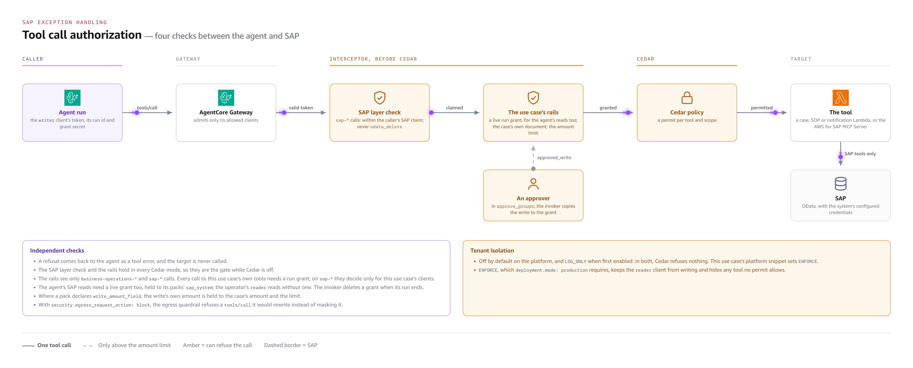

<!--
Copyright Amazon.com, Inc. or its affiliates. All Rights Reserved.
SPDX-License-Identifier: Apache-2.0
-->

# Security

Terms are defined in the [glossary](glossary.md) and in [Concepts](../../../docs/start/concepts.md).

The model has no authority of its own. What it may do is decided outside it: by the run checks,
by Cedar, by the tool Lambdas and by a person's approval. This page says what each one refuses.
The threat model, with what each control stops and how it was proven, is
[reference/threat-model.md](reference/threat-model.md). This page says "standard operating
procedure (SOP)" once, and "procedure" after that.

([Animated version](diagrams/authorization.gif))

## Run checks

A run grant is the permission that one run has. The agent invoker writes it before the run
starts, the run checks read it on every checked call, and the invoker deletes it when the run
ends. The grant exists so that only a real run, started by the invoker, can change a case or SAP.
The grant has a secret, which only the invoker and the agent know, so another client that learns
the run id still cannot use it.

([Animated version](diagrams/run-grant.gif))

The run checks are this use case's check inside the platform's Gateway interceptor
(`business_operations_check/`). They see only calls to targets whose names start with
`business-operations-`, and calls to the SAP layer's `sap-` targets. They run before Cedar, and
they refuse in every Cedar mode
([which limits refuse a call in each Cedar mode](architecture.md#sap-access-limits)). The synth
refuses the use case without them. For those calls, the run checks do the following:

- **On an SAP target, they decide only for this use case's own apps**, the ones its SAP access
  claim names. They pass every other caller unchanged. The SAP layer's check has already limited
  that caller to its own SAP access claim, and refuses `odata_delete` for everyone.
- **They require a run grant.** They refuse these tools unless `x-audit-correlation-id` names an
  unexpired run grant for the caller's own client, and the call includes the grant's secret:
  - a case tool (`get_case_state`, `update_case_state`, `send_notification`,
    `demo_create_ticket`), and `demo_get_ticket`;
  - a process-type tool (`load_sop`, `get_precedent`), and `search_sap_sops`;
  - an SAP write.
- **On a rehearsal's grant, or a question's (`ask`), they refuse every tool that changes data**:
  SAP writes, `update_case_state`, `demo_create_ticket` and `send_notification`.
- **They refuse an SAP write that does not name the document of the run's own case.** This is
  the case document check. The pack's `case_document_check` says which write parameters must
  equal which case key fields. A pack that declares none has every SAP write refused, and so does
  a run with no case.
- **They limit an SAP write to the pack's `AUTO_WRITE_LIMIT_USD`**, unless it is the one write
  that a person approved, field by field. That write is `approved_write` on the grant: the
  latest proposed write, or the write of the decision option that the person chose. A pushed
  amount never raises the limit. Above a pack's `DUAL_APPROVAL_LIMIT_USD`, where the pack
  declares one, that write needs two different approvers on the grant.
- **Where a pack declares `write_amount_field`, they also check the amount in the write
  itself** against the case's amount and the limit. A create or update that omits the field, or
  whose value is not a finite number, is refused. A function import (Release, Cancel) names a
  posted document's key. So it is checked only when it includes the field. Otherwise its amount
  is the case row's.
- **They refuse an SAP read by the agent's own client unless an active run grant names it.** The
  agent's own client is the `writer`, and also the console app when a person's token reaches
  SAP. A grant that names packs reads only those packs' `sap_system`. A grant with no packs (a
  discovery run) reads any system this use case claims. The operator's `reader` reads without a
  grant.
- **They keep a case, ticket, process-type or pack argument inside the grant's packs.**

Other tools on these targets, and every other use case's calls, pass unchanged. The run checks
read:

- the `use-cases/business-operations/run-checks` parameter, published by the main stack;
- the run-grants, cases, tickets and config tables;
- `registry.json`, which they cache for 60 seconds, so a pack published in the console takes
  effect within a minute.

They are bundled into the platform's interceptor, so a change to them deploys with the gateway
stack.

**What the run checks do not cover:**

- **Only the invoker writes run grants.** A run started any other way has every checked call
  refused. The run-grants table's policy denies every other writer. `verify.py` asks the invoker
  for two-minute test grants that name the `reader` client, and never a case or an approval.
- **Every client needs a run grant**, `reader` and `writer` included. So an MCP (Model Context
  Protocol) host that writes to SAP must start a run that the invoker grants. The `reader`'s SAP
  reads are the one exception.
- **A run grant ends with its run.** The invoker deletes the grant when the run ends, but only if
  the grant's secret hash matches its own. So a finished run's secret cannot be used again, and
  another run's grant is never changed. If the delete fails, the grant's expiry still ends it.
- **The check reads `agent_callers` from `use-cases/business-operations/run-checks`.** If the
  gateway stack deploys before the use case's stack publishes that parameter again, the agent's
  SAP reads are refused until it does. Deploy them together.
- **A throttled interceptor makes the Gateway refuse every call** (HTTP 500). So the run checks
  are not bypassed, but an outage stops every use case. A timeout or a function error was not
  tested ([threat model](reference/threat-model.md), BO-61).
- **Direct SAP calls do not pass them.** The poller, the ingest consumer and the test-data seeder
  call SAP outside the Gateway, and only on the systems in `bypass_gateway`
  ([SAP access](architecture.md#sap-access)). They sign in as the system's service account, the
  way the server does, or with the flow that the system's `unattended` block names. That block
  exists because these functions have no person behind them, so `obo` cannot sign them in. An
  `obo` system without the block cannot be called directly
  ([Unattended sign-in](../../../layers/sap/reference/sign-in.md#unattended-sign-in)).

## Cedar on the shared Gateway

The Gateway's `allowedClients` is one list, shared by every use case. Cedar refuses nothing in
two cases:

- Cedar is off (`security.cedar.enabled: false`, the platform default). This use case then creates
  none of its policies.
- Cedar is in `LOG_ONLY`, the mode that an enabled engine starts in.

In both cases, any allowed client, of this use case or of another use case, can call every tool
that the run checks do not check. These tools include the SAP reads on every system. These
clients can also call every other use case's tools. In every mode, the run checks still refuse an
SAP write, or a case, process-type or pack tool, from a caller without a run grant. They also
still refuse the agent's own client's SAP reads without a run grant. The table in
[SAP access limits](architecture.md#sap-access-limits) shows which limits refuse a call in each
Cedar mode.

Cedar `ENFORCE`, which `deployment.mode: production` requires, is what separates use cases. Under
`ENFORCE`:

- the reader client cannot write;
- a client without `uc-business-operations/*` scopes is not shown these tools at all;
- `tools/list` leaves out a tool that no permit allows, instead of refusing it.

Cedar repeats no check that a Lambda makes.

## Notifications

`send_notification` sends on one channel per deployment: Amazon SES or the sample ticket table.
Two checks in the notification Lambda apply in every Cedar mode:

- **Recipients default to the sender's own domain.** The agent picks a recipient from case data,
  which is not sanitized. This allowlist stops a crafted SAP field from sending an email to an
  outside address. To email a partner, list the partner's domain in
  `notification.recipient_domains`.
- **A guardrail screens every message.** The use case's own Amazon Bedrock guardrail checks the
  subject, body and recipient before any channel sees them. It refuses a message that includes a
  credential, a Social Security number (SSN) or a card number. If the guardrail cannot be
  reached, nothing is sent.

## Masking in stored data

A bank change or a duplicate-payment check needs the supplier's bank account, so nothing on the
way to the model masks it. What is stored after the run is masked. Under
`security.require_guardrails`, which `deployment.mode: production` requires, the use case creates
a persistence guardrail (`business_operations/persistence.py`). It anonymizes bank account,
routing, IBAN, SWIFT, ITIN, SSN and card numbers. These pass through it first
(`agent/utils/persist_mask.py`):

- the trace a run saves;
- the `live_run` snapshot of a run in progress;
- the case tool's title and description;
- the sample tickets;
- every notification;
- the text turns kept in AgentCore Memory.

When the guardrail cannot be reached, a trace or ticket stores a placeholder, and a notification
is not sent. Without the setting, there is no persistence guardrail, and nothing is masked.

AgentCore Memory never stores tool data, with or without the setting. A resumed run reloads only
the conversation's text turns. So the session manager stores each tool call with its input
emptied, and each tool result as a placeholder (`agent/utils/conversation.py`). A resumed run
that needs an SAP value reads it from SAP again. A masked text turn comes back to a resumed run
with the placeholder (`{US_BANK_ACCOUNT_NUMBER}`), not the value.

## Untrusted text in the prompt

The agent reads text other people write: SAP field values, ticket replies, operators' console
messages. Two treatments, both in `agent/utils/content_filter.py`, apply to all of it:

- **Filter.** `sanitize_external_content` replaces known injection phrasings ("ignore previous
  instructions", role prefixes such as `system:`, spoofed `<external_data>` or `<sop_document>`
  tags) with `[FILTERED]`, and logs the source and pattern label. Paraphrases, other languages and
  encoded text pass. The filter detects known phrasings only, and does not classify text.
- **Fence.** `fence_data` wraps the text in `<external_data source="…">` and tells the model to
  treat it as data only.

They are applied in three places:

- The ingest consumer filters every pushed record before it becomes a case
  (`pipeline/sap_ingest.py`).
- The prompt that starts a run filters and fences the ticket reply, ticket title and console
  message it includes (`agent/utils/payload.py`).
- Every tool result is filtered and fenced before the model reads it
  (`agent/utils/tool_result_fence.py`). This is the larger part: every SAP field the agent looks
  at.

Only the model's view is fenced. The stored history, the browser's view, the trace and the
evidence keep the raw result. `load_sop`, `search_sap_sops`, `search_sap_api_docs` and `skills`
are not fenced, because they return the agent's own procedure, which only pack authors can
change.

What this does not cover: SAP values at rest, which the poller stores unchanged, and anything
that no pattern matches. Fencing makes it less likely that text steers a run, but it is not a
security boundary. A run steered by text can still do what its grant allows. The run checks,
Cedar and the approval are the boundary.

## Audit-change alerts

The main stack sends an alert to the platform's ops topic when one of the following is written.
The alert names the call, the resource and the principal, never a value.

- The **deployment's trigger mode**, a **pack's trigger mode** or the **emergency stop**:
  `PutParameter` or `DeleteParameter` on
  `<ssm_prefix>/use-cases/business-operations/autonomy/trigger-mode`,
  `.../autonomy/emergency-stop`, or any name under `.../autonomy/packs/`. `<ssm_prefix>` is the
  deployment's prefix in AWS Systems Manager (SSM) Parameter Store. This includes the writes of
  automatic containment and of the emergency stop, so a stop and its clear each send an alert
  ([Observability](operating/observability.md)).
- **`registry.json`**, written or deleted.
- A **procedure**, written or deleted by anyone except its one writer, the pack composer, which
  the procedure routes invoke.
- The **procedure or registry bucket's policy** (`PutBucketPolicy`, `DeleteBucketPolicy`),
  including a deploy's write. That policy limits who may write procedures. So anyone else who
  writes a procedure must first change the policy, which sends this alert.

The trigger-mode and bucket-policy alerts are EventBridge rules on CloudTrail management events.
So they fire only while a trail logs management events in this Region: the platform's security
stack trail, or an organization trail. The registry and procedure alerts come from the buckets'
own event notifications, and need no trail. An alert reaches a person only once
`observability.alarm_email` is subscribed. `ops.py production-check` warns when no rule watches
the trigger-mode parameter.

## Console permissions

Every route needs `business-operations-users`. The other groups add these rights:

- `-admins`: change the trigger mode, and set and clear the emergency stop.
- `-authors`: author packs and procedures, and change contacts and rule values.
- `-limit-owners`: lower a pack's write limits in this stack.
- `-case-workers`: start the agent on a case to work it (**Process** on a case, and
  **Start *n* runs** on **Cases**).
- `-pack-admins`: change a pack's structure in development.
- `-remote-authors`: use this use case's tools on the platform's people Gateway, in addition to
  the groups each tool's route needs ([People Gateway](#people-gateway)).

Each is its own group, so you can map each one to a different identity provider (IdP) group
(`identity.group_map`), or map one IdP group to several. Checking a procedure without saving it
(`POST /packs/{pack_id}/sops/{process_type}/check`) needs what saving it needs. Adding or removing a
procedure changes the pack's mapping, so it also needs `-pack-admins`.

A pack's `entitlement` (`groups`, `approve_groups`, `author_groups`, `constant_groups`,
`limit_groups`, `process_groups`) restricts further. Its groups must be named
`business-operations-<group>`, because the user pool is shared. A pack that the published
registry does not list is refused to everyone. The route handler decides. What the console
hides is only presentation. Groups are added to a token at sign-in and on refresh.

Asking the assistant about a case needs only permission to see its pack, because a question
writes nothing. **Process** and **Start *n* runs**, the starts that may write, need
`business-operations-case-workers` and, where the pack sets them, its `process_groups`
([Runtime](reference/runtime.md#asking-and-processing)). Every decision on a case, including
approving a write, needs the pack's `approve_groups`.

## People Gateway

With the platform's `gateway.people` on and `people_tools` set, a person can read and author
packs and procedures from a remote MCP client, such as AWS Quick or Copilot Studio. The person is
signed in as themselves. Four checks stand between that client and a pack:

1. **The people Gateway's authorizer** accepts only its remote clients' tokens, or, with
   `gateway.people.issuer`, the organisation's own issuer's: no console token, and no agent's
   token. The interceptor then checks that issuer's tokens itself (threat-model row BO-76).
2. **The people interceptor** verifies the token again, and requires an access token issued for
   the people Gateway. It replaces the call's `caller` with the verified person. The token goes no
   further, and no target sees it.
3. **The people target** (`business-operations-people`) has a fixed set of tools, each one a
   console route: reads of packs, procedures, rules and versions, and the content writes. It
   refuses:
   - anything else;
   - a call without the Gateway's `caller`;
   - any argument a tool does not take;
   - a write limit;
   - more than 30 writes a minute by one person. Each function instance counts on its own, and
     the target runs at most two instances.

   Only the people Gateway's role may invoke it. It has no code that changes limits, the trigger
   mode, the emergency stop, structure or runs.
4. **The console's own code** decides the rest: `business-operations-users`, the new
   `business-operations-remote-authors`, the authors group, the pack's `author_groups` (and
   `constant_groups` for rule values), and development only for every write. The groups that
   change structure, limits or runs (`-admins`, `-pack-admins`, `-limit-owners`,
   `-case-workers`) are removed from every people call, whatever groups the person is in.

Each write creates a pack version, recorded against the person. The version and its audit record
include the path the write came by (`{via: people-gateway, client, by, display}`). So the
Versions tab and the review before a published version show which changes came from an external
AI. `put_sop` refuses a procedure that has any lint finding. Every write names the version it was
based on (`based_on`), so a write based on an old version is refused, instead of overwriting a
colleague's edit. `author` is refused at synth outside a development stack. A person loses a
removed group at their next access token, within 15 minutes.
`aws cognito-idp admin-user-global-sign-out` ends their refresh tokens at once.

A document that an external AI reads can steer it into writing a harmful procedure. These limits
apply to that change:

- It is made in development only, as a version with a diff and the person's name.
- It reaches production only through the review of the published version that the
  [production checklist](production-checklist.md) asks for.
- The agent's write checks apply to whatever a procedure says.

**A case worker can cause SAP writes with no approval.** The run checks allow a write at or under
the pack's `AUTO_WRITE_LIMIT_USD` for whoever started the run. So starting a run gives as much
power as approving a write under that limit. Map `business-operations-case-workers`, and each
pack's `process_groups`, to people you would trust with that.
